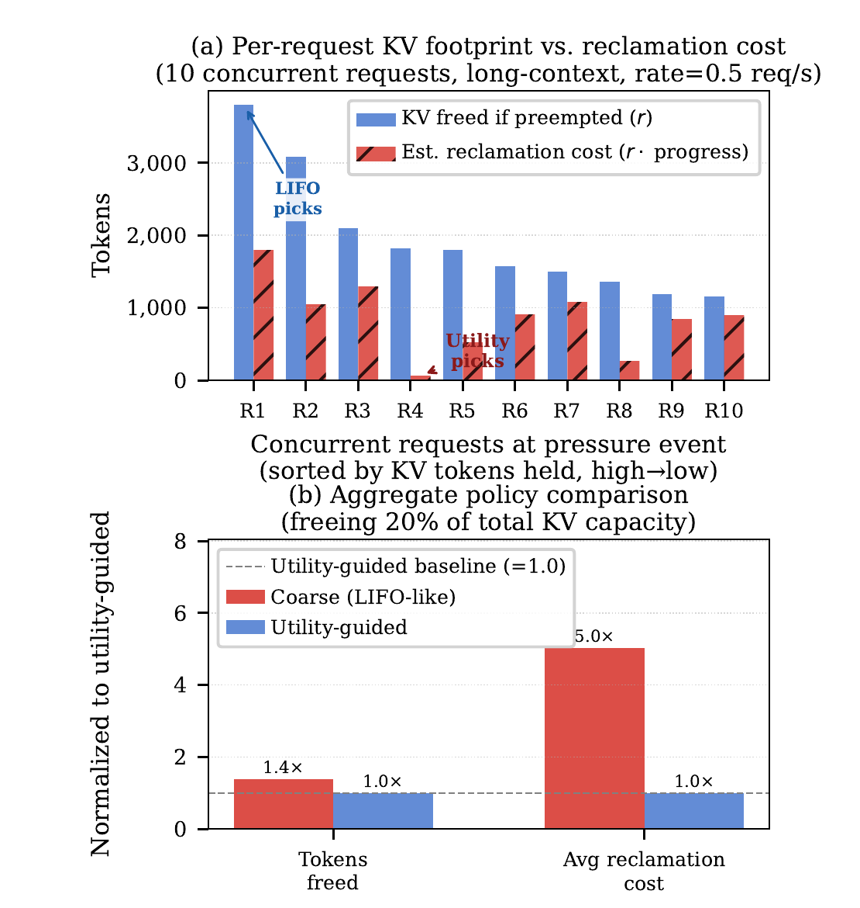
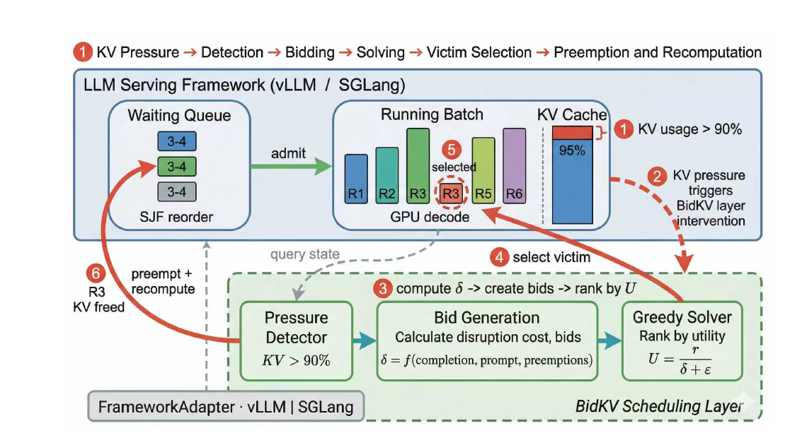
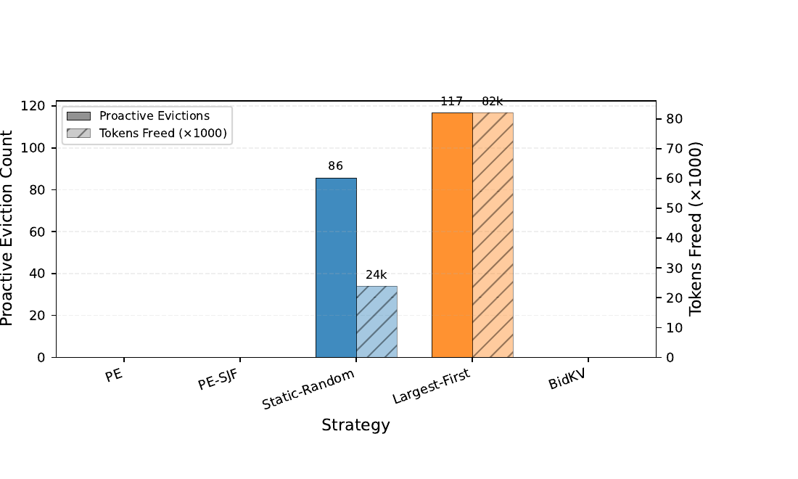

## 摘要

在线 LLM 服务过程中，当 KV 缓存需求超过 GPU 显存容量时，服务引擎会从活跃请求中回收缓存，以便接纳等待中的请求。糟糕的牺牲者（victim）选择会浪费重算工作、推迟排队请求的准入，并恶化首 token 延迟——这是用户可以直接感知的指标。现有策略依赖粗粒度的请求顺序启发式（LIFO、FCFS）或独立的单请求打分规则，既缺乏显式的回收代价信号，也缺乏跨请求协调。我们提出 BidKV，一种效用引导的回收策略，用于改善 KV 压力下的准入响应性。每个活跃请求产生一个投标（bid），编码可回收容量与估计的中断代价；在每次压力事件中，在线效用排序选择策略找出预期效用最高的牺牲者，并通过框架原生机制抢占它。当前原型在重算回退语义下，用请求生命周期代理指标（完成进度、提示长度、抢占历史）实例化中断代价。BidKV 通过可移植适配层以非侵入方式集成 vLLM 与 SGLang。在 NVIDIA RTX A6000 上使用 Llama-3.1-8B-Instruct 和 ShareGPT 轨迹评估，BidKV 相比 vLLM 原生策略将 P95 TTFT 降低 89%，将 300 ms SLO 达成率提高 14.9 个百分点，代价是适度的吞吐损失。

## 1 引言

在线大语言模型（LLM）服务必须在有限的 GPU 显存上支撑不断变化的并发请求集合。在生产负载中，请求在提示长度、生成长度和到达模式上高度异构；它们的推进也是异步的——一些请求仍在预填充（prefill），另一些已经深入解码（decode）[11, 22, 24]。在这种长度混合、突发性强的负载下，键值（KV）缓存成为主要的运行时资源 [16, 19]：新到达的请求分配 KV 状态，进行中的请求逐 token 扩展它，完成或被抢占的请求则在生命周期的不同时点释放它。因此，聚合 KV 需求在短时间尺度上不断波动，并经常逼近硬件容量上限；现代服务引擎会在饱和前的高水位阈值触发回收，从活跃请求中回收 KV 状态，以保留调度灵活性，并确保新请求到达时仍有低代价的牺牲者可选。

此时的核心问题不是“是否必须回收 KV 容量”，而是“应该选择哪个活跃请求作为牺牲者”。两个请求可能占用相近的 KV 显存，但被中断时产生的代价差异巨大。在当前服务引擎采用的重算回退执行模型下 [11]，回收一个活跃请求会释放其 KV 状态，但该请求被重新调度时必须通过框架原生的恢复路径从头开始。因此，回收代价不仅取决于释放了多少显存，还取决于丢弃了多少有用计算、之后又必须重做多少。回收一个接近完成的请求会浪费大量已完成工作并带来昂贵的重算；而回收一个刚进入解码不久的请求，可能以低得多的系统扰动释放相近的容量。糟糕的牺牲者选择还会级联：重算会重新推高 KV 需求，进而触发更多回收——这个循环让 KV 容量被正在重算的牺牲者占用，而不是留给等待中的请求。直接后果是准入延迟恶化：排队请求等待首 token 的时间变长，推高首 token 延迟（TTFT），侵蚀服务水平目标（SLO）达成率。因此，活跃 KV 回收本质上是一个跨请求的牺牲者选择问题，其质量直接决定持续 KV 压力下的准入响应性。

由于回收代价存在异质性，调度器需要显式的单请求代价信号来区分“便宜”和“昂贵”的牺牲者；由于选择是跨请求的，这些信号必须进入协调式的跨请求选择，而不是各自独立的单请求规则。现有系统无法同时提供这两点。当前的调度启发式——LIFO 抢占 [11]、FCFS 准入 [22]、EDF 式等待策略 [8]——只决定牺牲者顺序，没有任何单请求代价信号；分块预填充 [1] 和预填充-解码分离 [15, 26] 等更广泛的服务创新提升了吞吐与资源放置，但继承了同样的基于顺序的牺牲者选择，信号缺口依然存在。H2O [23] 和 StreamingLLM [21] 等 token 级打分方法确实产生了请求相关的重要性信号，但每种方法都独立地施加固定打分规则——没有批次级协调时，局部合理的单请求选择可能在全局上代价高昂。缺失的是一条信号通路：一个结构化接口，使单请求的回收敏感度能够被呈递给调度器，并用于协调式的跨请求牺牲者选择。

本文提出 BidKV，一种面向活跃 KV 回收的、基于投标的调度抽象。核心思想是把回收敏感度变成显式的结构化信号，而不是调度顺序的隐式结果。每个活跃请求产生一个投标，概括回收后可释放的 KV 容量，以及反映回收该请求相对代价的代理式中断估计。给定所有活跃请求的投标，调度器执行在线效用排序的跨请求牺牲者选择：在每次压力事件中，选择“单位估计中断代价可回收 KV 容量最大”的请求作为预期牺牲者，并通过框架原生机制抢占它。这样，BidKV 把牺牲者选择从一种不透明的运行时行为，转变为打分层（估计单请求回收敏感度）与协调选择层（按跨请求回收效用一个候选排序）之间的显式接口。

在当前原型中，中断估计在重算回退语义 [11] 下由请求生命周期特征（完成进度、提示长度、抢占历史）实例化。BidKV 通过一个可移植适配层，以非侵入方式同时集成 vLLM [11] 与 SGLang [25]，完整复用两个框架原生的回收与恢复路径——两种集成都无需修改源码，这证明投标接口与框架特定的调度内部实现是清晰分离的。BidKV 控制“回收哪个请求”，而不控制“如何回收”。在重算回退执行下，该策略不改变最终输出；差异完全体现在牺牲者选择上。主要收益是改善准入响应性：通过选择那些能以低回收代价释放足够容量的牺牲者，BidKV 缩短等待请求排队等待 KV 分配的时间，从而降低 TTFT、提高 SLO 达成率。代价是适度的吞吐与逐 token 解码延迟损失，这一权衡有利于延迟敏感型部署。收益依赖运行区间：在持续的长度混合 KV 压力下，效用引导选择带来显著收益；在低压力下，牺牲者选择仍由框架原生顺序主导，BidKV 的重排只在持续高压条件下启用。

总结起来，本文有以下贡献：

1. **基于投标的回收接口。** 我们引入结构化的投标抽象，使单请求回收敏感度能够呈递给运行时调度器，用显式决策接口替代隐式的牺牲者排序规则。
2. **打分与选择解耦的架构。** 我们通过结构化投标接口，将请求级中断估计与协调式跨请求牺牲者选择分离，使选择层无论中断估计如何产生，都只处理统一的“代价–容量”对。
3. **可移植的运行时集成。** 我们将 BidKV 实现为带 `FrameworkAdapter` 抽象的非侵入调度层，并展示其与 vLLM、SGLang 的集成；集成复用各框架原生的回收与恢复机制，无需修改源码。
4. **受控条件下的结构化评估。** 我们在冻结的请求轨迹和校准的到达率下评估五种策略，这些策略在调度维度（准入排序、运行队列重排、牺牲者选择逻辑和主动回收）上有所不同，从而支持在这些共变维度上进行结构化归因。

## 2 背景与动机

### 2.1 KV 缓存内存模型

每个自回归解码步骤都会为所有已生成的 token 缓存 key 和 value 投影 [19]。对于有 $L$ 层、$H$ 个 KV 头（通过分组查询注意力 [2]）、头维度为 $d_h$ 的模型，一个长度为 $n$ 的请求存储 $2LHd_h n$ 个元素。在 bf16 精度下，Llama-3.1-8B-Instruct（$L=32$，$H=8_{\mathrm{kv}}$，$d_h=128$）每个 token 分配 128 KiB [7]。vLLM [11] 通过 PagedAttention 管理这些状态：物理 GPU 显存被划分为固定大小的块，并通过块表映射到逻辑位置。

按这个逐 token 开销，单个 4,096 token 的请求就已经消耗约 512 MiB 的 KV 状态。总 KV 需求按 $O(B \cdot \bar{n})$ 扩展，其中 $B$ 是批大小，$\bar{n}$ 是平均序列长度；而可用于 KV 分配的显存，在扣除模型权重、激活缓冲区和运行时开销之后是固定的。因此，并发度和序列长度在竞争同一个有限池，生产级服务负载经常把 KV 利用率推到接近饱和，迫使引擎从活跃请求中回收 KV 状态。回收决策的质量——即驱逐哪些请求——直接影响尾延迟和吞吐，下面我们将其形式化。

### 2.2 牺牲者选择问题

在重算回退语义 [11] 下，每次回收事件都会释放牺牲者的 KV 块并重新排队该请求；重新调度时，其提示会被从头重算。调度器在每次事件中的任务，是从活跃请求集合 $R$ 中选择一个牺牲者集合 $V \subseteq R$，使得释放的总容量满足缺口，同时最小化总回收代价：

$$
\min_{V \subseteq R}\ \sum_{i \in V} c_i
\quad \text{s.t.}\quad
\sum_{i \in V} r_i \ge N ,
\tag{1}
$$

其中 $r_i$ 是回收请求 $i$ 释放的 KV 容量，$c_i$ 是回收代价——包括被丢弃的计算、重新排队延迟，以及被重算请求重新进入运行队列所带来的级联压力——$N$ 是容量缺口。在重算回退执行下，$c_i$ 的主要组成部分是已经投入到牺牲者上的工作；第 4.2 节用请求级生命周期特征推导的代理量来实例化 $c_i$。最小化总回收代价与准入响应性单调相关：代价更低的牺牲者让更少的 KV 容量被非生产性的重新预填充占用，从而加速队列排空，缩短排队请求被接纳前的等待时间。

该形式化是最小代价覆盖问题 [10] 的一个实例。在请求异构时，$V$ 的选择很重要：两个请求可能释放相近的容量，但回收代价相差一个数量级。现有引擎并未显式求解这个选择问题。vLLM 选择最近被调度的请求（LIFO）[11]；其他系统采用 FCFS [22] 或 EDF 排序 [8]，它们都不考虑单请求回收代价。这一分析引出两个需求。第一，调度器应接受显式的单请求回收代价信号，以刻画候选之间的异质性，而不是只依赖到达顺序或调度顺序。第二，牺牲者选择应进行跨请求协调——考虑释放容量与产生代价之间的批次级权衡——而不是孤立地给每个请求打分。

**执行模型。** 本文始终采用当前服务引擎使用的标准重算回退执行模型 [11]：回收请求会释放其 KV 块，并在重新调度时重新排队、完整重算提示；回收策略不改变最终输出 token。

**经验证据。** 图 1 展示了来自长上下文 ShareGPT 轨迹（速率 = 0.5 req/s）的一次 KV 压力快照中的牺牲者选择缺口；在绝对规模更小的长度混合负载下也会出现同样效应（第 6 节）。面板 (a) 显示了峰值 KV 利用率下的 10 个并发请求，按持有的 token 数排序。LIFO 命中 R1 和 R2——KV 足迹最大的请求——但这两个请求分别完成了 47% 和 34%，估计回收代价约为 1,800 和 1,050 个被丢弃工作的 token（红色斜线柱）。效用引导策略则选择 R4，它只完成了 3%：释放 1,825 个 token，回收代价仅 62 个 token——仅这一个牺牲者选择就带来 29 倍的成本效率提升。

面板 (b) 汇总了以释放总 KV 容量 20% 为目标的对比。LIFO 每次事件多回收 1.4 倍 token（因为偏好更大的请求），但平均回收代价高 5.0 倍。粗粒度牺牲者选择用不成比例的代价负担换取边际的额外 KV 回收，在之后的每个调度步骤中放大尾延迟恶化。



## 3 相关工作

*LLM 服务系统。* vLLM [11] 引入 PagedAttention，并通过请求级抢占（交换或重算）处理 KV 压力。Orca [22] 开创了连续批处理的迭代级调度；DistServe [26] 与 Splitwise [15] 将预填充和解码阶段分离；Sarathi-Serve [1] 引入分块预填充以减少流水线气泡。FlexGen [17] 将 KV 状态卸载到 CPU/磁盘以扩展有效容量，LoongServe [20] 则对长上下文采用弹性序列并行。Prompt Cache [5] 与 Hydragen [9] 利用前缀共享避免冗余 KV 计算。这些系统在批处理、放置和内存管理等互补维度上推进了技术，但都没有把牺牲者选择当作一等的优化目标：实现了抢占的系统仍默认采用基于顺序的启发式（LIFO 或 FCFS），不包含单请求回收代价信号。

*Token 级 KV 缓存压缩。* H2O [23] 通过累积注意力分数识别“重击者”（heavy-hitter）token。StreamingLLM [21] 为无限流式生成保留注意力汇 token。Scissorhands [13] 利用重要性持久性假设。SnapKV [12] 对注意力特征进行聚类以压缩前缀缓存。KIVI [27] 采用非对称 2-bit KV 量化。PyramidKV [3] 通过金字塔分配为不同层分配自适应预算。这些方法有效降低了单请求 KV 足迹，但每种方法都在单个请求内部操作：保留规则独立于批次中的其他请求。在标准形式下，它们不跨请求协调“哪个请求应该让出容量”，也不向调度器暴露回收代价信息。

*调度理论与多资源分配。* 主导资源公平（Dominant Resource Fairness）[4] 与多资源装箱（multi-resource packing）[6] 形式化了异构集群资源的分配。背包问题文献 [10, 14] 为受限子集选择提供了算法基础——这与理想化牺牲者选择形式化（式 1）背后的组合结构相同。这些框架假设物品代价是给定输入，并且有离线求解器可用。在 LLM 服务中，单请求回收代价必须在运行时从服务状态估计，选择必须在严格延迟约束下、于引擎的调度循环内完成。BidKV 不精确求解组合问题，而是使用在线效用排序近似：在每个调度步骤按回收效应对请求排序，并在每次压力事件中消费排名最高的条目（第 4.3 节）。

*定位。* 现有服务系统实现了抢占机制，但按调度顺序选择牺牲者；token 级压缩方法产生了单请求重要性信号，但在每个请求内部独立施加。据我们所知，此前没有系统把显式的单请求回收代价信号与协调式跨请求牺牲者选择结合起来——这正是第 2.2 节识别出的两个需求。BidKV 用一个与打分器无关、可跨框架移植的接口填补这一空白：单请求信号——无论来自 token 级打分器还是请求生命周期特征——被结构化为投标，效用排序的在线选择过程在批次层面协调选择（第 4 节）。

## 4 设计

第 2 节识别出的牺牲者选择问题提出两个需求：显式的回收敏感度信号，以及跨请求协调。另有两个设计目标指导我们的架构：*与打分器无关的接口*——因为最佳重要性信号可能随负载和模型变化，打分策略应可替换，而无需修改选择算法或运行时集成；以及*框架可移植性*——机制应通过复用原生回收与恢复路径，集成到异构服务引擎（如 vLLM、SGLang）中，且无需修改源码。

这些目标自然分为两部分：通用架构——与执行模型无关的、基于投标的数据通路和分层分解；以及当前实例化路径——在重算回退语义下使用请求生命周期特征的特定中断估计器（$\delta$，式 3）。架构规定打分信号如何流向选择层；实例化决定本文中哪些特征填充 $\delta$。

BidKV 将逻辑组织为四层（图 2）：*运行时适配层*检测 KV 压力，并通过框架原生机制执行回收；*投标生成层*从请求生命周期特征计算中断代价并生成结构化投标；*效用排序选择层*产生缓存的回收优先级排序；*投标信号层*定义所有层共享的数据结构。



### 4.1 投标信号层

通信的原子单元是*调度投标*（scheduling bid），一个冻结（不可变）的数据类，包含以下字段：

- `bid_id` —— 唯一标识符。
- `request_id` —— 该投标对应的推理请求。
- $r$（`tokens_freed`）—— 若抢占该请求可释放的 KV token 数。
- $\delta$（`disruption estimate`）—— 一个代理调度代价（$\ge 0$），估计回收该请求造成的系统级扰动。值越低，表示抢占该请求带来的调度扰动越小。在重算回退下（本文），$\delta$ 由请求级特征（完成进度、提示长度和抢占历史；式 3）推导；其他请求级打分器可以在不改变架构的情况下填充 $\delta$。
- `confidence` $\in [0,1]$ —— 打分器对 $\delta$ 的置信度。
- `metadata` —— 策略特定的信息。

每个投标携带一个派生效用属性：

$$
U(b) = \frac{b.r}{b.\delta + \varepsilon},
\qquad \varepsilon = 10^{-3}.
\tag{2}
$$

高效用比意味着抢占该请求能以低回收代价释放大量 token。通过偏好高效用牺牲者，选择策略降低总回收代价，让 KV 容量对排队请求保持可用，从而改善准入响应性（TTFT 与 SLO 达成率）。

投标被收集到 `BidPool`——某一时刻所有活跃投标的不可变快照。选择输出是活跃投标的效用排序；运行时适配器在每次压力事件中消费当前排名最高的条目。

### 4.2 投标生成层

投标生成层将单请求状态转换为结构化投标。填充 $\delta$ 的特征选择是一个实例化决策；本文在重算回退语义下使用请求生命周期代理指标，详见下文。每个运行中的请求贡献一个投标，$r$ 等于其当前 KV 足迹，$\delta$ 按如下方式计算。令 $\hat{r} = \max(\beta, n_{\text{prompt}}/n_0)$ 为提示归一化的重算代价（以 $\beta$ 为下限，避免极短提示看起来可以免费驱逐）。中断估计是三个可加项之和：

$$
\delta = \max\left(\delta_{\min},\;
\underbrace{\hat{r}}_{\text{recompute}} +
\underbrace{w_c c^2}_{\text{completion}} +
\underbrace{w_s P}_{\text{starvation}}\right),
\tag{3}
$$

其中 $c = \min(1, n_{\text{output}}/n_{\max})$ 是完成比例，$P$ 统计此前的抢占次数。

三项共享同一单位：$n_0=256$ token 提示的重算代价（即基线处 $\hat{r}=1$）。在此单位下，$w_c=2.0$ 表示驱逐一个完全完成的请求，其扰动程度相当于重新预填充一个 512 token 的提示；$w_s=0.5$ 表示每次先前抢占增加半个基线重算代价。下限 $\beta=0.5$ 确保即使极短提示也带有不可忽略的回收代价。完成项是二次的：在 90% 完成度驱逐请求，浪费的累积解码工作是 45% 完成度时的四倍，反映了接近完成的请求价值急剧上升。由于 $\delta$ 纯粹作为排序信号，排序过程只要求保持相对顺序；精确量级无需校准到绝对代价（第 7 节）。

### 4.3 在线效用排序的牺牲者选择

式 1 给出了理想的批次回收目标；实际服务需要一种能嵌入引擎基于 tick 的调度循环的在线近似。在每个调度步骤，`GreedyBidSolver` 为每个活跃投标计算回收效用分数，并产生所有候选的效用排序（算法 1）。该排序被缓存并周期性刷新；在每次压力事件中，运行时适配器消费当前排名最高的条目并执行一次原生抢占。

效用分数直接来自式 2：$U = r/(\delta+\varepsilon)$。效用越高，表示该请求在单位估计回收扰动下释放的 KV 容量越多；排名最高的请求就是预期效用最高的牺牲者。由于 $\delta$ 作为序数排序信号，选择只要求投标之间的相对顺序保持一致——不需要精确量级校准。

排序过程的时间复杂度为 $O(B \log B)$。实际中 $B < 100$，排序只需微秒级时间——相对于一个解码步骤可以忽略。

```algorithm title="按效用排序的牺牲者顺序" label="算法 1"
输入: 投标池 P = {b1, b2, ..., bB}
输出: 按效用排序的顺序 O
1: 对 P 中所有 b 执行
2:   U(b) <- b.r / (b.delta + eps)        ⊲ 回收效用，eps = 1e-3
3: 结束循环
4: 按 U(b) 降序排序 P -> O
5: 返回 O                                 ⊲ 缓存；适配器在每次压力事件中弹出队首条目
```

### 4.4 运行时适配层

为实现框架可移植性，BidKV 定义了一个 `FrameworkAdapter` 抽象基类，包含五项职责：

1. **KV 统计可见性：** 返回当前和最大 token 数，用于压力检测。
2. **压力事件拦截：** 拦截框架原生抢占路径，并先调用 BidKV 的求解器。
3. **回收执行：** 委托给框架原生抢占机制。
4. **打分回调：** 向打分策略提供解码步骤信号（例如新生成的 token），用于优先级更新。
5. **生命周期管理：** 请求完成时清理投标和状态。

该契约有意保持最小化：任何暴露 KV 统计和回收入口的服务框架都可以实现该适配器。

## 5 实现

BidKV 实现为一个零外部依赖的独立 Python 包（仅使用 Python $\ge$ 3.10 标准库），总计约 12,000 行代码。系统默认关闭，并提供全局紧急开关，可在生产环境中即时绕过。策略通过可插拔注册表管理；新增策略只需实现一个接口并调用一次注册函数。

### 5.1 vLLM 集成

我们使用 vLLM 0.17.1（v1 架构）的插件系统进行集成。BidKV 的基本集成点是牺牲者选择：适配器按回收效用对运行中的请求排序，并把执行完全委托给 vLLM 原生抢占机制——释放所有 KV 块并重新排队请求以进行完整重算。BidKV 不修改 vLLM 的 KV 缓存协调器或块池；它只控制回收哪个请求。在重算回退语义下，牺牲者选择策略不改变最终输出。

适配器在三个时点拦截调度：

1. **调度前（Pre-schedule）。** 在每次原生调度调用之前，钩子执行五个子步骤：
    - (a) *准入重排：* 策略按 SJF（提示长度）或 FCFS 对等待队列排序（见表 1）。
    - (b) *牺牲者优先级刷新*（每 3 s）：在运行集合上调用每个策略的 `select_victims()`，产生缓存的优先级排序。BidKV 使用完整的投标流水线（式 2–3），按效用 $U = r/(\delta+\varepsilon)$ 对候选排序；其他策略使用更简单的启发式。
    - (c) *主动抢占*（KV > 90%、等待队列非空、运行请求 $\ge$ 3、冷却 5 s）：从缓存排序中抢占优先级最低的运行请求，通过 vLLM 原生机制执行。PE 和 PE-SJF 跳过此步骤（无干预基线）。
    - (d) *SRPT 抢占*（仅 Static-Random、Largest-First，KV > 80%，冷却 1.5 s）：若某运行请求的估计剩余工作超过最便宜等待请求总代价的 1.2 倍，则抢占它。BidKV 禁用 SRPT：在重算回退语义下，长提示牺牲者的重新预填充代价通常超过调度收益。
    - (e) *运行队列重排：* 启用该步骤的策略按缓存优先级对运行列表排序，使 vLLM 原生 LIFO 驱逐移除优先级最低的请求。BidKV 将该重排限制在 KV 利用率 > 95% 且平均提示长度 $\le$ 500 token 时；适配器把高回收效用映射为低保留优先级，因此原生 LIFO 后端移除的最低优先级请求，正好对应排序中预期效用最高的牺牲者。
2. **解码后跟踪。** 每个解码步骤后，将新采样的 token 追加到单请求状态，用于打分。
3. **生命周期清理。** 请求完成时，清除投标和状态。

**策略差异。** 表 1 总结了五种实验策略在调度维度上的差异。它们共享相同的回收执行路径（vLLM 原生抢占）。BidKV 的核心差异在步骤 (b)：决定回收优先级的、基于投标的效用排序。步骤 (a)、(c)、(e) 配置准入排序、主动抢占触发条件和队列管理，这些在多个被评估策略之间共享；步骤 (d) 仅由启发式基线使用。由于这些维度在策略之间共变，第 6 节把性能差异归因于组合调度配置，而不是孤立的机制。

表 1：五种策略在调度维度上的差异。所有策略共享相同的执行机制（vLLM 原生抢占）。“prio” = 完成度感知的保留分数；“gated” = 仅当 KV 利用率 >95% 且平均提示长度 ≤500 时启用重排。SRPT = 最短剩余处理时间抢占（KV>80%）。LIFO* = 不进行由策略管理的牺牲者选择；由 vLLM 原生后进先出驱逐决定回收哪个请求。
{: .table-caption #tab-1 }

| 策略 | 等待队列 | 运行队列 | 牺牲者选择 | 主动回收 | SRPT |
| --- | --- | --- | --- | :---: | :---: |
| PE（默认） | FCFS | LIFO | LIFO* | ✗ | ✗ |
| PE-SJF | SJF | LIFO | LIFO* | ✗ | ✗ |
| Static-Random | SJF | prio | 随机 | ✓ | ✓ |
| Largest-First | SJF | prio | 容量优先 | ✓ | ✓ |
| BidKV | SJF | gated | $U=\frac{r}{\delta+\varepsilon}$ | ✓ | ✗ |

### 5.2 SGLang 集成

`SGLangAdapter` 通过挂钩调度入口与 SGLang 的 RadixAttention 引擎 [25] 集成。为测试可移植性，我们在不修改 SGLang 内部实现的情况下，将 BidKV 的完整调度策略（SJF 准入排序、压力门控的运行队列重排、效用排序牺牲者选择）部署到 SGLang，并与 Vanilla SGLang（SGLang 原生基于 LRU 的驱逐，不进行调度管理）和 Random-Evict（BidKV 适配器，但用随机牺牲者选择替代效用排序）进行比较。

## 6 评估

我们从五个维度评估 BidKV：(1) 整体服务性能（6.2 节）；(2) 对到达率的敏感性（6.3 节）；(3) 长上下文负载（6.4 节）；(4) 回收事件分析（6.5 节）；(5) 在 SGLang 上的框架可移植性（6.6 节）。

### 6.1 实验设置

**硬件与模型。** 所有实验在单块 NVIDIA RTX A6000 GPU（48 GiB）上运行，CUDA 12.5。我们以 bf16 精度服务 Llama-3.1-8B-Instruct [7]（模型权重约 16 GiB）。

**推理引擎。** 以 vLLM 0.17.1（v1 架构）与 PagedAttention [11] 作为主要定量平台。我们将 GPU 显存利用率限制为 0.5，并把 KV 缓存容量固定为 600 个块（9,600 token），以在所有请求速率下制造持续的 KV 压力。

**负载与轨迹。** 主评估使用长度混合负载：从 ShareGPT Vicuna 未过滤数据集 [18] 中采样 1,000 个请求，其长度分布能代表真实世界的 LLM 对话 [24]。提示长度从数十 token 到数千 token，形成异构 KV 足迹，正好触发 2.2 节形式化的牺牲者选择问题：当引擎回收显存时，请求在释放的 KV 容量和造成的回收代价上都差异巨大。请求按泊松过程（开环）到达，速率为 {2.0, 3.8, 5.7} req/s。补充的长上下文负载（500 个请求，速率 0.35/0.5/0.7 req/s）测试极端 KV 压力下的行为，其中单个请求经常消耗 2,000–4,000 token。所有轨迹以种子 42 生成，并通过 SHA-256 校验和验证；所有策略共享相同轨迹。

**SLO 定义。** 我们将 SLO 达成率定义为 TTFT 低于给定阈值的请求比例。对混合负载报告 300 ms 的 SLO——这是能产生可测量策略差异（3–15 个百分点）的最严格阈值；对长上下文负载报告 2,000 ms 的 SLO。

**指标。** 四个主要指标从互补维度刻画服务质量：吞吐（req/s）——每秒完成的请求总数，LLM 服务中的标准容量指标 [11, 22, 25]；SLO 达成率——TTFT 落在上述阈值内的请求比例；TTFT P95——尾部首 token 延迟，是准入响应性最直接的度量；以及 TPOT P95 [1]——逐 token 输出时间的 95 分位，刻画解码阶段延迟。四个指标合起来覆盖预填充（TTFT）、解码（TPOT）、吞吐和 SLO 达成率。所有尾延迟指标使用 P95 而非 P99：在我们的样本规模下（1,000 个请求 × 3 次运行），每次运行的 P99 由约 10 个极端值决定，而 P95 由约 50 个值决定，前者带来的运行间方差更高。

**基线。** 五种策略构成分层对比，变化等待队列排序、运行队列重排、主动回收和牺牲者选择逻辑（表 1）：

1. **PE（vLLM 默认）：** FCFS 准入、LIFO 抢占、无主动回收。
2. **PE-SJF：** PE 加 SJF 等待队列排序；隔离准入队列重排的贡献。
3. **Static-Random：** SJF 准入、主动回收（KV > 90%）、随机牺牲者选择、SRPT 抢占（KV > 80%）。
4. **Largest-First：** SJF 准入、主动回收、容量贪心牺牲者——驱逐占用 KV 块最多的请求；启用 SRPT。
5. **BidKV：** SJF 准入、压力门控的运行队列重排（KV > 95%）、完成度感知代价估计（$\delta$，式 3）→ 投标 → 效用排序牺牲者；启用主动回收（KV > 90%），显式禁用 SRPT。

该对比覆盖了一系列回收哲学：PE 不施加主动调度；PE-SJF 隔离准入排序的贡献；Static-Random 和 Largest-First 用简单启发式加入主动回收；BidKV 用效用排序的跨请求牺牲者选择替代所有单请求启发式。该递进中的每一步同时改变多个维度（表 1）；我们把性能差异归因于共变特征组，而不是声称严格的单变量隔离。每种配置重复三次；我们报告多次运行的均值。

### 6.2 主对比

我们从表 2 中的中等到达率（3.8 req/s）开始，此时 KV 压力持续存在，但系统尚未饱和。

**关键发现。**

- **在速率 = 3.8 时，BidKV 取得最佳 TTFT P95。** TTFT P95 为 631 ms，比 Largest-First（677 ms）低 7%，比 Static-Random（1,216 ms）低 48%。SLO(300ms) 达到 83.2%，比 Static-Random（84.1%）低 0.9 个百分点，但比 Largest-First（79.9%）高 3.3 个百分点，比 PE（68.4%）高 14.8 个百分点。
- **启用 SRPT 的策略在吞吐和 TPOT 上领先。** Static-Random 取得最高吞吐（3.57 req/s，BidKV 为 3.42）和最低 TPOT P95（90.9 ms，BidKV 为 107.2 ms），这得益于激进的 SRPT 抢占（KV > 80%）。然而，其 TTFT P95 高出约 2 倍（1,216 ms 对 631 ms），表明激进的吞吐回收以准入延迟为代价。
- **SJF 准入是最大的单一因素。** PE-SJF——PE 加 SJF 等待队列排序，无主动回收或 SRPT——将 SLO 从 68.4% 提高到 79.6%（+11.2 个百分点），并把 TTFT P95 降低 90%（6,769→666 ms）。然而，吞吐下降 12%（3.48→3.06 req/s），TPOT P95 恶化（97.0→153.5 ms），说明仅靠准入重排就引入了延迟–吞吐权衡。
- **BidKV 有意禁用 SRPT。** 当 KV 使用率超过 80% 时，SRPT 会激进抢占运行较久的请求，为等待请求释放容量，但增加被驱逐牺牲者的重算。BidKV 显式禁用 SRPT：BidKV 的打分准则已经通过 $\delta$ 计入估计回收代价，避免了激进回收可能触发的级联抢占。

**归因链。** 分层对比分离出四组共变特征：(1) PE → PE-SJF（SLO +11.2 个百分点，TTFT 6,769→666 ms）：仅 SJF 准入就带来了对比中最大的延迟下降——TTFT 降低一个数量级，因为短提示请求不再排长请求之后。(2) PE-SJF → Static-Random（SLO +4.5 个百分点，吞吐 3.06→3.57 req/s，TTFT 666→1,216 ms）：加入主动回收、运行队列重排、SRPT 和随机牺牲者选择后，吞吐恢复（+17%），SLO 进一步提高，但尾部 TTFT 几乎翻倍。(3) Static-Random → Largest-First（SLO −4.2 个百分点，TTFT 1,216→677 ms）：用容量贪心替代随机牺牲者选择，把尾延迟几乎减半，但 SLO 下降，因为更保守的选择每次事件释放的总容量更少。(4) Largest-First → BidKV（SLO +3.3 个百分点，TTFT 677→631 ms）：用效用排序的跨请求牺牲者选择替代容量启发式并禁用 SRPT，证明回收代价感知的牺牲者协调在简单基于大小的启发式之外提供了增量价值。

### 6.3 速率敏感性

表 2 展示了性能如何在三个到达率下扩展。

**三个运行区间。** 低负载（速率 = 2.0）：KV 压力很大程度上被快速请求周转吸收。BidKV 在全部四个指标上领先（SLO 97.0%，TTFT 258 ms，TPOT 72.4 ms），但绝对差距很小：吞吐差距 $\le$0.01 req/s，所有策略的 SLO 都 $\ge$92%。

中等负载（速率 = 3.8）：持续的 KV 压力迫使主动回收；这是主要的区分区间（表 2，速率 = 3.8）。Static-Random 在吞吐（3.57 req/s）和 TPOT（90.9 ms）上领先，得益于 SRPT。然而，其 TTFT P95（1,216 ms）几乎是 BidKV（631 ms）的 2 倍。BidKV 取得最佳 TTFT P95 和次佳 SLO（83.2%），比 Static-Random 低 0.9 个百分点，但比 Largest-First 高 3.3 个百分点，比 PE 高 14.8 个百分点。PE-SJF 在没有主动回收的情况下达到 79.6% SLO——高于 PE（68.4%），但低于主动抢占的策略，说明仅靠准入排序不足以最大化 SLO。

高负载（速率 = 5.7）：所有策略在强压力下都退化。BidKV 在 SLO（81.0%）上领先；PE-SJF 通过保守调度（无主动抢占）取得最低 TTFT P95（727 ms），但吞吐更低（3.28 对 BidKV 3.60 req/s），SLO 也更低（74.6%）。Static-Random 取得最高吞吐（4.09 req/s，比 BidKV 高 13.6%），但其 TTFT P95 高 2.2 倍（1,792 ms）。

**跨速率总结。** 对三个速率取平均，BidKV 取得最佳 SLO（87.1%）和 TTFT P95（562 ms，比 Static-Random 的 1,091 ms 低 48%），吞吐为 2.99 req/s——比 Static-Random 的 3.21 req/s 低 6.8%。这一权衡反映了 BidKV 的设计点：约 7% 的吞吐代价，换取持续 KV 压力下显著更好的准入响应性。

表 2：速率敏感性（混合负载，vLLM）。三个到达率下的四个主要指标。每个速率的最佳值加粗，次佳值加下划线。3 次运行的均值。
{: .table-caption #tab-2 }

| 策略 | 速率 (req/s) | SLO (300ms, %) | TTFT P95 (ms) | 吞吐 (req/s) | TPOT P95 (ms) |
| --- | ---: | ---: | ---: | ---: | ---: |
| PE（默认） | 2.0 | **92.0** | 683 | **1.96** | 78.1 |
| | 3.8 | 68.4 | 6769 | <u>3.48</u> | <u>97.0</u> |
| | 5.7 | 56.2 | 8699 | 3.49 | 119.9 |
| PE-SJF | 2.0 | 94.2 | 330 | **1.96** | 84.6 |
| | 3.8 | 79.6 | <u>666</u> | 3.06 | 153.5 |
| | 5.7 | 74.6 | **727** | 3.28 | 150.6 |
| Static-Random | 2.0 | <u>96.5</u> | <u>266</u> | **1.96** | <u>72.8</u> |
| | 3.8 | **84.1** | 1216 | **3.57** | **90.9** |
| | 5.7 | <u>80.4</u> | 1792 | **4.09** | **94.4** |
| Largest-First | 2.0 | 95.5 | 291 | **1.96** | 74.5 |
| | 3.8 | 79.9 | 677 | 3.28 | 112.9 |
| | 5.7 | 77.7 | <u>793</u> | 3.53 | 113.2 |
| BidKV | 2.0 | **97.0** | **258** | **1.96** | **72.4** |
| | 3.8 | <u>83.2</u> | **631** | 3.42 | 107.2 |
| | 5.7 | **81.0** | 797 | <u>3.60</u> | <u>110.0</u> |

### 6.4 长上下文负载

表 3 将评估扩展到长上下文负载（500 个请求，速率 = 0.70 req/s，SLO 阈值 2,000 ms）。KV 压力更严重：典型请求消耗 2,000–4,000 token，仅两到四个并发请求就能占满 9,600 token 的 KV 预算。PE 崩溃（SLO 5.0%，TTFT 约 95 s），说明无管理的 LIFO 回收在长上下文流量下不可行。在四个主动策略中，Largest-First 在 SLO 上领先（64.4%）——当所有请求都很长时，驱逐最大请求释放的容量最多，这正是容量贪心选择擅长的区间。BidKV 取得最佳 TTFT P95（30,143 ms，比 Static-Random 好 5%，比 PE-SJF 好 25%），SLO 也具竞争力（62.3%，比 Largest-First 低 2.1 个百分点）。PE-SJF 取得最佳 TPOT P95（145.2 ms），但 TTFT 最差（37,551 ms），说明当 KV 压力极端时，仅靠准入排序是不够的。BidKV 的 TTFT 优势与混合负载中的机制相同：效用排序选择避免了浪费性重算，让预填充带宽对排队请求保持可用。

表 3：峰值请求速率下的长上下文负载（vLLM，Llama-3.1-8B-Instruct，A6000，每次运行 500 个请求，速率 = 0.70 req/s，SLO 阈值 2,000 ms，3 次独立运行的均值）。在更低速率（0.35 和 0.50 req/s）下，所有主动策略的 SLO 均 > 70%；相对排序在定性上一致。最佳值加粗，次佳值加下划线。
{: .table-caption #tab-3 }

| 策略 | SLO (2000 ms, %) | TTFT P95 (ms) | 吞吐 (req/s) | TPOT P95 (ms) |
| --- | ---: | ---: | ---: | ---: |
| PE（默认） | 5.0 | 94696 | 0.413 | <u>184.1</u> |
| PE-SJF | <u>63.6</u> | 37551 | <u>0.563</u> | **145.2** |
| Static-Random | 57.4 | <u>31693</u> | **0.568** | 208.3 |
| Largest-First | **64.4** | 33345 | 0.542 | 239.6 |
| BidKV | 62.3 | **30143** | 0.560 | 207.0 |

### 6.5 回收事件分析

图 3 揭示了速率 = 3.8 时性能差异背后的机制：

- PE 触发零次主动驱逐，完全依赖 vLLM 的反应式 LIFO 机制。这避免了回收代价，但放弃了为等待请求释放显存的机会，导致高 TTFT 和低 SLO。
- PE-SJF 触发零次主动驱逐，完全依赖 vLLM 的反应式 LIFO 机制——回收行为与 PE 完全相同。然而，仅 SJF 准入就把 SLO 从 68.4% 提高到 79.6%，说明准入排序对调度质量的贡献大于被动回收策略。
- Largest-First 按 KV 占用选择牺牲者，目标是持有最多缓存块的请求。由于不考虑跨请求回收代价，它偶尔会命中重算昂贵的接近完成请求，造成级联压力。
- BidKV 使用 $U = r/(\delta+\varepsilon)$ 维护牺牲者候选的缓存效用排序；每次压力事件消费排名最高的条目。中断项 $\delta$ 随完成进度和先前抢占次数增长，引导选择转向那些能以低回收代价释放足够容量的请求。这在速率 = 3.8 时产生最佳 TTFT P95，同时保持有竞争力的 SLO。



### 6.6 框架可移植性

表 4 报告了在 SGLang RadixAttention 引擎 [25] 上、最高压力速率（5.7 req/s，混合负载）下的结果。SGLang 适配器应用了 BidKV 的完整调度策略——SJF 准入排序、压力门控的运行队列重排和效用排序牺牲者选择——镜像 vLLM 配置，且不修改 SGLang 内部实现。

**调度管理与原生驱逐。** Vanilla SGLang 的原生 LRU 驱逐取得 55.2% SLO 和 6,246 ms 的 TTFT P95——吞吐尚可（3.04 req/s），但准入延迟严重。在 SGLang 上部署 BidKV 的完整策略后，SLO 提高到 86.9%（+31.7 个百分点），TTFT P95 降至 598 ms（降低 10.4 倍），证明该策略在架构不同的服务引擎上仍然有效。

**跨框架可移植性。** BidKV 也优于 Random-Evict（SLO 86.9% 对 85.7%，TTFT P95 598 对 878 ms），且运行间方差明显更低：Random-Evict 的 TTFT P95 在三次运行中跨度为 460–1,700 ms，而 BidKV 为 475–667 ms。吞吐差距在 0.7% 以内（5.53 对 5.57 req/s）。关键的可移植性结论在于这一模式：在 vLLM 和 SGLang 上，BidKV 的调度策略都以可忽略的吞吐代价取得最佳 SLO 和 TTFT P95，证明完整策略（包括其集成钩子）无需框架特定调优即可跨服务框架迁移。

表 4：框架可移植性：SGLang（混合负载，速率 = 5.7 req/s，Llama-3.1-8B-Instruct，A6000，每次运行 1,000 个请求，SLO 阈值 300 ms，3 次运行的均值）。Vanilla SGLang 不施加策略管理的牺牲者选择；Random-Evict 和 BidKV 分别以随机和效用排序牺牲者选择部署 BidKV 适配器。主动策略中最佳值加粗，次佳值加下划线。† Vanilla SGLang 的低 TPOT 反映的是无阻碍的解码吞吐，而不是准入效率；其 6,246 ms 的 TTFT P95 表明准入延迟严重恶化。
{: .table-caption #tab-4 }

| 策略 | SLO (300 ms, %) | TTFT P95 (ms) | 吞吐 (req/s) | TPOT P95 (ms) |
| --- | ---: | ---: | ---: | ---: |
| Vanilla SGLang | 55.2 | 6246 | 3.04 | 58.7† |
| Random-Evict | <u>85.7</u> | <u>878</u> | **5.57** | <u>88.9</u> |
| BidKV | **86.9** | **598** | <u>5.53</u> | **85.4** |

## 7 讨论与局限

### 7.1 代理式中断代价估计

中断估计 $\delta$（式 3）是由请求生命周期特征推导的排序信号，而不是精确的回收代价预言机。精确代价预测没有必要：在重算回退语义下，调度器的任务是对牺牲者候选排序，使回收相对便宜的请求优先于昂贵的请求。三个特征——完成进度、提示长度和抢占历史——刻画了第 2 节建立的回收代价异质性维度，只需在这些维度上保持相对顺序，就能把选择引向低代价牺牲者。

由于被回收请求会由框架原生恢复路径完整重算，策略保持输出正确性；策略决定每次压力事件中回收哪个请求。这个选择直接塑造准入响应性：代价感知的牺牲者排序减少浪费性重算，让 KV 容量对排队请求保持可用，降低 TTFT 并提高 SLO 达成率（第 6 节）。

### 7.2 局限

- **单 GPU。** 所有实验使用单块 A6000。多 GPU 部署可能为投标收集引入协调开销。
- **单模型规模。** 我们在 Llama-3.1-8B-Instruct 上评估。KV 与权重比例不同的更大模型（70B+）可能表现出不同的压力动态。
- **执行模型。** 所有实验使用重算回退语义，这是 vLLM 与 SGLang 的默认恢复路径。替代执行模型（例如交换到主机、部分截断）可能改变代价结构；让打分器适配这类模型是未来工作。

### 7.3 更广泛影响

由于投标把单请求中断敏感度变成调度器的显式输入，该接口可以编码 SLO 差异化的服务：更高优先级的请求表达更高的中断代价，从而在回收时获得更强保护。一个后果是，低优先级请求可能承担不成比例的抢占事件。单请求抢占上限——限制任一请求在一个调度窗口内被回收的次数——提供了直接的防护；探索更丰富的公平感知调度扩展留待未来工作。

## 8 结论

我们提出了 BidKV，一种面向在线 LLM 服务中活跃 KV 回收的、基于投标的调度抽象。BidKV 把单请求回收敏感度呈现为显式的结构化信号，并执行在线效用排序的跨请求牺牲者选择，用效用引导的决策接口（$U = r/(\delta+\varepsilon)$）替代隐式排序启发式。在重算回退语义下，策略保持输出正确性；差异在于每次压力事件中选择哪个请求进行回收——这个选择直接决定排队请求多快获得 KV 分配，进而影响首 token 延迟和 SLO 达成率。

通过在 vLLM 上使用 Llama-3.1-8B-Instruct、在长度混合的 ShareGPT 负载下进行五策略评估，我们展示了 BidKV 取得最佳的跨速率 SLO 达成率（87.1%）和 TTFT P95（562 ms），以适度的吞吐代价（约 7%）优于容量贪心启发式和默认调度基线。在低负载下，BidKV 在全部四个指标上领先。在中高负载下，启用激进 SRPT 抢占的策略用尾延迟换取吞吐；BidKV 在持续 KV 压力下提供最佳准入响应性。补充的长上下文评估确认，当异构请求生命周期在回收代价上形成可操作的差异时，收益最为明显。

BidKV 通过可移植适配器抽象集成 vLLM 与 SGLang，复用各框架原生的回收与恢复路径，无需修改源码。打分与选择解耦的架构使打分策略和选择算法可以独立演化。未来工作包括用于部分 KV 释放的 token 级截断、公平感知的调度扩展，以及多 GPU 协调。

## 参考文献

1. Amey Agrawal, Nitin Kedia, Ashish Panwar, Jayashree Mohan, Nipun Kwatra, Bhargav S. Gulavani, Alexey Tumanov, and Ramachandran Ramjee. 2024. Taming Throughput-Latency Tradeoff in LLM Inference with Sarathi-Serve. In *Proceedings of the 18th USENIX Symposium on Operating Systems Design and Implementation (OSDI)*.
2. Joshua Ainslie, James Lee-Thorp, Michiel de Jong, Yury Zemlyanskiy, Federico Lebrón, and Sumit Sanghai. 2023. GQA: Training Generalized Multi-Query Transformer Models from Multi-Head Checkpoints. arXiv:2305.13245 [cs.CL]. <https://arxiv.org/abs/2305.13245>
3. Zefan Cai, Yichi Zhang, Bofei Gao, Yuliang Liu, Yucheng Li, et al. 2025. PyramidKV: Dynamic KV Cache Compression based on Pyramidal Information Funneling. arXiv:2406.02069 [cs.CL]. <https://arxiv.org/abs/2406.02069>
4. Ali Ghodsi, Matei Zaharia, Benjamin Hindman, Andy Konwinski, Scott Shenker, and Ion Stoica. 2011. Dominant Resource Fairness: Fair Allocation of Multiple Resource Types. In *Proceedings of the 8th USENIX Symposium on Networked Systems Design and Implementation (NSDI)*.
5. In Gim, Guojun Chen, Seung seob Lee, Nikhil Sarda, Anurag Khandelwal, and Lin Zhong. 2024. Prompt Cache: Modular Attention Reuse for Low-Latency Inference. arXiv:2311.04934 [cs.CL]. <https://arxiv.org/abs/2311.04934>
6. Robert Grandl, Ganesh Ananthanarayanan, Srikanth Kandula, Sriram Rao, and Aditya Akella. 2014. Multi-resource packing for cluster schedulers. In *Proceedings of the 2014 ACM Conference on SIGCOMM* (Chicago, Illinois, USA) (SIGCOMM '14). Association for Computing Machinery, New York, NY, USA, 455–466. <https://doi.org/10.1145/2619239.2626334>
7. Aaron Grattafiori, Abhimanyu Dubey, Abhinav Jauhri, Abhinav Pandey, Abhishek Kadian, et al. 2024. The Llama 3 Herd of Models. arXiv:2407.21783 [cs.AI]. <https://arxiv.org/abs/2407.21783>
8. Arpan Gujarati, Reza Karimi, Safya Alzayat, Wei Hao, Antoine Kaufmann, Ymir Vigfusson, and Jonathan Mace. 2020. Serving DNNs Like Clockwork: Performance Predictability from the Bottom Up. In *Proceedings of the 14th USENIX Symposium on Operating Systems Design and Implementation (OSDI)*, 443–462.
9. Jordan Juravsky, Bradley Brown, Ryan Ehrlich, Daniel Y. Fu, Christopher Ré, and Azalia Mirhoseini. 2024. Hydragen: High-Throughput LLM Inference with Shared Prefixes. arXiv:2402.05099 [cs.LG]. <https://arxiv.org/abs/2402.05099>
10. Hans Kellerer, Ulrich Pferschy, and David Pisinger. 2004. *Knapsack Problems*. Springer. <https://doi.org/10.1007/978-3-540-24777-7>
11. Woosuk Kwon, Zhuohan Li, Siyuan Zhuang, Ying Sheng, Lianmin Zheng, Cody Hao Yu, Joseph Gonzalez, Hao Zhang, and Ion Stoica. 2023. Efficient Memory Management for Large Language Model Serving with PagedAttention. In *Proceedings of the 29th Symposium on Operating Systems Principles* (Koblenz, Germany) (SOSP '23). Association for Computing Machinery, New York, NY, USA, 611–626. <https://doi.org/10.1145/3600006.3613165>
12. Yuhong Li, Yingbing Huang, Bowen Yang, Bharat Venkitesh, Acyr Locatelli, Hanchen Ye, Tianle Cai, Patrick Lewis, and Deming Chen. 2024. SnapKV: LLM Knows What You are Looking for Before Generation. arXiv:2404.14469 [cs.CL]. <https://arxiv.org/abs/2404.14469>
13. Zichang Liu, Aditya Desai, Fangshuo Liao, Weitao Wang, Victor Xie, Zhaozhuo Xu, Anastasios Kyrillidis, and Anshumali Shrivastava. 2023. Scissorhands: Exploiting the Persistence of Importance Hypothesis for LLM KV Cache Compression at Test Time. arXiv:2305.17118 [cs.LG]. <https://arxiv.org/abs/2305.17118>
14. Silvano Martello and Paolo Toth. 1990. *Knapsack Problems: Algorithms and Computer Implementations*. John Wiley & Sons.
15. Pratyush Patel, Esha Choukse, Chaojie Zhang, Aashaka Shah, Íñigo Goiri, Saeed Maleki, and Ricardo Bianchini. 2025. Splitwise: Efficient Generative LLM Inference Using Phase Splitting. In *Proceedings of the 51st Annual International Symposium on Computer Architecture* (Buenos Aires, Argentina) (ISCA '24). IEEE Press, 118–132. <https://doi.org/10.1109/ISCA59077.2024.00019>
16. Reiner Pope, Sholto Douglas, Aakanksha Chowdhery, Jacob Devlin, James Bradbury, et al. 2022. Efficiently Scaling Transformer Inference. arXiv:2211.05102 [cs.LG]. <https://arxiv.org/abs/2211.05102>
17. Ying Sheng, Lianmin Zheng, Binhang Yuan, Zhuohan Li, Max Ryabinin, et al. 2023. FlexGen: High-Throughput Generative Inference of Large Language Models with a Single GPU. arXiv:2303.06865 [cs.LG]. <https://arxiv.org/abs/2303.06865>
18. TeamShareGPT. 2023. ShareGPT Conversations Dataset.
19. Ashish Vaswani, Noam Shazeer, Niki Parmar, Jakob Uszkoreit, Llion Jones, Aidan N. Gomez, Łukasz Kaiser, and Illia Polosukhin. 2017. Attention is all you need. *Advances in Neural Information Processing Systems* 30 (2017).
20. Bingyang Wu, Shengyu Liu, Yinmin Zhong, Peng Sun, Xuanzhe Liu, and Xin Jin. 2024. LoongServe: Efficiently Serving Long-Context Large Language Models with Elastic Sequence Parallelism. In *Proceedings of the ACM SIGOPS 30th Symposium on Operating Systems Principles* (Austin, TX, USA) (SOSP '24). Association for Computing Machinery, New York, NY, USA, 640–654. <https://doi.org/10.1145/3694715.3695948>
21. Guangxuan Xiao, Yuandong Tian, Beidi Chen, Song Han, and Mike Lewis. 2024. Efficient Streaming Language Models with Attention Sinks. arXiv:2309.17453 [cs.CL]. <https://arxiv.org/abs/2309.17453>
22. Gyeong-In Yu, Joo Seong Jeong, Geon-Woo Kim, Soojeong Kim, and Byung-Gon Chun. 2022. Orca: A Distributed Serving System for Transformer-Based Generative Models. In *Proceedings of the 16th USENIX Symposium on Operating Systems Design and Implementation (OSDI)*, 521–538.
23. Zhenyu Zhang, Ying Sheng, Tianyi Zhou, Tianlong Chen, Lianmin Zheng, et al. 2023. H2O: Heavy-Hitter Oracle for Efficient Generative Inference of Large Language Models. arXiv:2306.14048 [cs.LG]. <https://arxiv.org/abs/2306.14048>
24. Lianmin Zheng, Wei-Lin Chiang, Ying Sheng, Tianle Li, Siyuan Zhuang, et al. 2024. LMSYS-Chat-1M: A Large-Scale Real-World LLM Conversation Dataset. In *Proceedings of the 12th International Conference on Learning Representations (ICLR)*.
25. Lianmin Zheng, Liangsheng Yin, Zhiqiang Xie, Chuyue Sun, Jeff Huang, et al. 2024. SGLang: Efficient Execution of Structured Language Model Programs. In *Advances in Neural Information Processing Systems 37 (NeurIPS 2024)*.
26. Yinmin Zhong, Shengyu Liu, Junda Chen, Jianbo Hu, Yibo Zhu, Xuanzhe Liu, Xin Jin, and Hao Zhang. 2024. DistServe: Disaggregating Prefill and Decoding for Goodput-optimized Large Language Model Serving. In *Proceedings of the 18th USENIX Symposium on Operating Systems Design and Implementation (OSDI)*.
27. Zirui Liu, Jiayi Yuan, Hongye Jin, Shaochen Zhong, Zhaozhuo Xu, Vladimir Braverman, Beidi Chen, and Xia Hu. 2023. KIVI: Plug-and-play 2bit KV Cache Quantization with Streaming Asymmetric Quantization. <https://doi.org/10.13140/RG.2.2.28167.37282>
