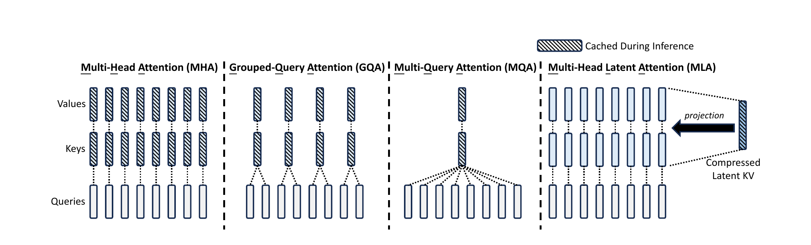

## Abstract

We present DeepSeek-V2, a strong Mixture-of-Experts (MoE) language model characterized by economical training and efficient inference. It comprises 236B total parameters, of which 21B are activated for each token, and supports a context length of 128K tokens. DeepSeek-V2 adopts innovative architectures including Multi-head Latent Attention (MLA) and DeepSeekMoE. MLA guarantees efficient inference through significantly compressing the Key-Value (KV) cache into a latent vector, while DeepSeekMoE enables training strong models at an economical cost through sparse computation. Compared with DeepSeek 67B, DeepSeek-V2 achieves significantly stronger performance, and meanwhile saves 42.5% of training costs, reduces the KV cache by 93.3%, and boosts the maximum generation throughput to 5.76 times. We pretrain DeepSeek-V2 on a high-quality and multi-source corpus consisting of 8.1T tokens, and further perform Supervised Fine-Tuning (SFT) and Reinforcement Learning (RL) to fully unlock its potential. Evaluation results show that, even with only 21B activated parameters, DeepSeek-V2 and its chat versions still achieve top-tier performance among open-source models.

## 1 Introduction

Large language models continue to scale, but training and inference costs remain a barrier to widespread deployment. A dense model activates all parameters for every token; during autoregressive generation, the KV cache also grows linearly with context length and becomes a bottleneck in memory capacity and bandwidth. DeepSeek-V2 attacks both problems at once:

- **Attention:** MLA jointly compresses keys and values into a low-rank latent vector. At inference, only that latent vector is cached; the up-projection matrices are absorbed into the query/output projections, so full K/V never needs to be materialized.
- **Feed-forward network:** DeepSeekMoE uses fine-grained expert segmentation and shared-expert isolation to obtain stronger expert specialization at the same activated-parameter budget, with device-limited routing, load-balancing losses, and token dropping to control communication and training stability.

DeepSeek-V2 has 236B total parameters, 21B activated per token, and supports a 128K context. Compared with DeepSeek 67B, it is stronger on benchmarks such as MMLU while saving 42.5% of training cost, reducing the KV cache by 93.3%, and increasing maximum generation throughput by 5.76×. The model is pretrained on 8.1T tokens, then fine-tuned on 1.5M conversational sessions with SFT and aligned with online GRPO.

The main contributions are:

1. MLA, which reduces per-token KV cache from $2n_h d_h l$ to $(d_c+d_h^R)l$ through low-rank KV joint compression while matching or exceeding MHA quality.
2. Decoupled RoPE, which moves positional information into a small set of extra query/key dimensions so that the KV up-projections remain absorbable.
3. DeepSeekMoE, which activates only 21B of 236B parameters and enables economical training and efficient inference.
4. A complete pretraining, long-context extension, SFT, and RL pipeline, with open model weights and inference code.

## 2 Architecture

DeepSeek-V2 remains a Transformer: each block contains an attention module and an FFN. The attention module uses MLA, and the FFN uses DeepSeekMoE; other details such as RMSNorm and activation functions largely follow DeepSeek 67B.

### 2.1 Multi-Head Latent Attention

Standard MHA must cache all historical keys and values during generation. As context grows, this KV cache becomes the main limit on batch size and sequence length. MQA and GQA reduce the cache by sharing key/value heads across query heads, but usually lose quality. MLA aims to shrink the cache substantially without sacrificing — and in practice improving — expressiveness.

#### 2.1.1 Standard Multi-Head Attention

Let $d$ be the embedding dimension, $n_h$ the number of attention heads, $d_h$ the per-head dimension, and $h_t\in\mathbb{R}^d$ the input of token $t$ at one layer. MHA first computes

$$
q_t=W^Q h_t,\qquad
k_t=W^K h_t,\qquad
v_t=W^V h_t,
$$

with $W^Q,W^K,W^V\in\mathbb{R}^{d_h n_h\times d}$, then slices them into $n_h$ heads:

$$
[q_{t,1};\dots;q_{t,n_h}]=q_t,\quad
[k_{t,1};\dots;k_{t,n_h}]=k_t,\quad
[v_{t,1};\dots;v_{t,n_h}]=v_t.
$$

The output of head $i$ is

$$
o_{t,i}=\sum_{j=1}^{t}
\mathrm{Softmax}_j\left(
\frac{q_{t,i}^{\top}k_{j,i}}{\sqrt{d_h}}
\right)v_{j,i},
\qquad
u_t=W^O[o_{t,1};\dots;o_{t,n_h}],
$$

where $W^O\in\mathbb{R}^{d\times d_h n_h}$. Inference must cache $2n_h d_h l$ elements per token ($l$ layers) — the target of MLA.

#### 2.1.2 Low-Rank Key-Value Joint Compression

MLA jointly compresses keys and values. A down-projection maps the input into a low-dimensional latent space, and two up-projections reconstruct keys and values:

$$
c_t^{KV}=W^{DKV}h_t,\qquad
k_t^C=W^{UK}c_t^{KV},\qquad
v_t^C=W^{UV}c_t^{KV},
$$

where $c_t^{KV}\in\mathbb{R}^{d_c}$ is the compressed latent vector, $d_c\ll d_h n_h$; $W^{DKV}\in\mathbb{R}^{d_c\times d}$ is the down-projection, and $W^{UK},W^{UV}\in\mathbb{R}^{d_h n_h\times d_c}$ are the up-projections. At inference, only $c_t^{KV}$ is cached, reducing the per-token, per-layer KV cache from $2n_h d_h$ to $d_c$.

Crucially, $W^{UK}$ can be absorbed into $W^Q$, and $W^{UV}$ into $W^O$. Inference therefore never needs to materialize full keys and values: query–key products can be computed in the latent space, and the weighted sum of values can be accumulated before a single up-projection. This is the **Absorb** operation. It makes MLA behave like an MQA-style structure with one shared large KV head at inference, combining a small cache with low compute.

To reduce activation memory during training, MLA also compresses queries (this does not reduce KV cache):

$$
c_t^Q=W^{DQ}h_t,\qquad
q_t^C=W^{UQ}c_t^Q,
$$

where $c_t^Q\in\mathbb{R}^{d_c'}$ and $d_c'\ll d_h n_h$.

#### 2.1.3 Decoupled Rotary Position Embedding

DeepSeek-V2 wants RoPE's positional encoding, but RoPE is not directly compatible with low-rank KV compression. RoPE is position-sensitive for both keys and queries: applying it to $k_t^C$ couples $W^{UK}$ with a position-dependent rotation matrix. That matrix sits between $W^Q$ and $W^{UK}$ at inference and prevents absorption, because matrix multiplication does not commute. The engine would have to recompute keys for all prefix tokens, erasing the benefit of compression.

MLA therefore uses **decoupled RoPE**: extra multi-head queries $q_{t,i}^R$ and a shared key $k_t^R$ carry positional information only:

$$
[q_{t,1}^R;\dots;q_{t,n_h}^R]
=q_t^R=\mathrm{RoPE}(W^{QR}c_t^Q),
\qquad
k_t^R=\mathrm{RoPE}(W^{KR}h_t).
$$

The position-free compressed part and the RoPE part are concatenated:

$$
q_{t,i}=[q_{t,i}^C;q_{t,i}^R],
\qquad
k_{t,i}=[k_{t,i}^C;k_t^R],
$$

$$
o_{t,i}=\sum_{j=1}^{t}
\mathrm{Softmax}_j\left(
\frac{q_{t,i}^{\top}k_{j,i}}{\sqrt{d_h+d_h^R}}
\right)v_{j,i}^C,
\qquad
u_t=W^O[o_{t,1};\dots;o_{t,n_h}],
$$

where $d_h^R$ is the per-head dimension of the decoupled queries/key. The decoupled key $k_t^R$ is also cached, so total KV cache is $(d_c+d_h^R)l$. Positional information occupies a small fraction of dimensions, while the main K/V path remains absorbable — the key to combining RoPE with low-rank compression.

#### 2.1.4 Comparison of Key-Value Cache

Table 1 compares per-token KV cache across MHA, GQA, MQA, and MLA. DeepSeek-V2 sets $d_c=4d_h$ and $d_h^R=d_h/2$, so MLA needs $(4d_h+0.5d_h)l=4.5d_h l$, equal to GQA with 2.25 groups, while reporting stronger quality than MHA.

Table 1: Per-token KV cache and capability of different attention mechanisms.
{: .table-caption #tab-1 }

| Mechanism | KV cache per token (elements) | Capability |
| --- | ---: | --- |
| Multi-Head Attention (MHA) | $2n_h d_h l$ | Strong |
| Grouped-Query Attention (GQA) | $2n_g d_h l$ | Moderate |
| Multi-Query Attention (MQA) | $2d_h l$ | Weak |
| MLA (ours) | $(d_c+d_h^R)l\approx 4.5d_h l$ | Stronger |

The figure highlights MLA's counterintuitive design: it still has many query heads, but all heads share one compressed KV latent vector. Absorption folds the up-projections into query/output at inference, approaching MQA's cache efficiency while retaining MHA-level expressiveness.

### 2.2 DeepSeekMoE Overview

The FFN uses DeepSeekMoE with two key ideas:

- **Fine-grained expert segmentation:** each expert is smaller, so a token can combine more experts and specialization has more room.
- **Shared-expert isolation:** a set of always-active shared experts captures common knowledge and reduces redundancy among routed experts.

For token $t$,

$$
h_t'=u_t+\sum_{i=1}^{N_s}\mathrm{FFN}_i^{(s)}(u_t)
+\sum_{i=1}^{N_r}g_{i,t}\mathrm{FFN}_i^{(r)}(u_t),
$$

where $N_s$ and $N_r$ are the numbers of shared and routed experts, $g_{i,t}$ is the routing gate, and only the top-$K_r$ routed experts are active. To keep MoE efficient under expert parallelism, DeepSeek-V2 adds device-limited routing (each token's experts span at most $M$ devices; $M\ge3$ in practice), expert-/device-/communication-level load-balancing losses, and a token-dropping strategy late in training. As a result, only 21B of 236B parameters are active per token.

## 3 Pre-Training and Evaluation

DeepSeek-V2 is pretrained on 8.1T tokens from a high-quality, multi-source corpus; relative to DeepSeek 67B, the corpus is larger, higher-quality, and contains more Chinese data. After pretraining, YaRN extends the default 4K context to 128K. YaRN is applied only to the decoupled shared key $k_t^R$, because that is the only part carrying RoPE. This detail matters: once MLA isolates positional information, long-context extrapolation only needs to touch that small set of dimensions.

On evaluation, DeepSeek-V2 reaches top-tier open-model quality on MMLU, Chinese tasks, code, and math. The headline efficiency numbers are: 42.5% lower training cost, 93.3% smaller KV cache, and 5.76× higher maximum generation throughput than DeepSeek 67B. The 93.3% reduction comes mainly from MLA's KV compression; the throughput gain comes from the smaller cache (larger feasible batches) together with MoE sparsity.

## 4 Alignment

Alignment has two stages:

1. **SFT:** about 1.5M conversational sessions covering math, code, writing, reasoning, and safety produce DeepSeek-V2 Chat (SFT).
2. **RL:** GRPO from DeepSeekMath performs online human-preference alignment, producing DeepSeek-V2 Chat (RL).

The paper reports MT-Bench 8.97, a 38.9% length-controlled win rate on AlpacaEval 2.0, and 7.91 on AlignBench for DeepSeek-V2 Chat (RL). It also discusses two practical observations: with fewer than 10K SFT instances, IFEval degrades noticeably; and RL alignment introduces an "alignment tax" — open-ended generation improves while standard benchmarks such as BBH may drop. DeepSeek-V2 trades off the two through data processing and training strategy.

## 5 Conclusion, Limitation, and Future Work

DeepSeek-V2 shows that MLA + DeepSeekMoE can deliver strong quality, low training cost, and efficient inference with 236B total / 21B activated parameters. Its limitations are those common to LLMs: knowledge is not continuously updated after pretraining, it may produce non-factual or hallucinated content, and training data is mainly Chinese and English, limiting other languages. DeepSeek released the model weights and inference code, plus DeepSeek-V2-Lite (15.7B total, 2.4B activated) for the community.

For today's systems reader, the lasting value of DeepSeek-V2 is that it turns "KV cache is the inference bottleneck" into a composable architectural design: low-rank compression, matrix absorption, and decoupled RoPE together form the MLA paradigm. DeepSeek-V3/R1, TransMLA, and many MLA inference optimizations build on this paradigm.

## Further Reading

- [TransMLA: converting GQA models to MLA](../transmla/index.html)
- [RoFormer: rotary position embedding (RoPE)](../roformer/index.html)
- [BidKV: utility-guided preemption under KV pressure](../bidkv/index.html)
