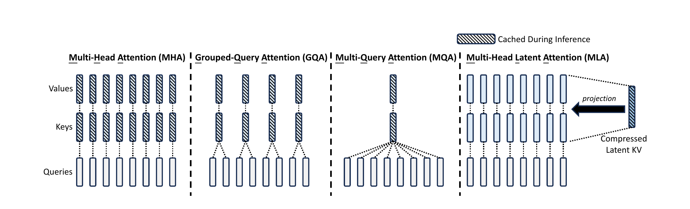

## 摘要

DeepSeek-V2 是一个强大的混合专家（MoE）语言模型，以经济的训练和高效的推理为特征。它总参数量为 236B，每个 token 激活 21B，支持 128K 的上下文长度。DeepSeek-V2 采用多头潜变量注意力（MLA）与 DeepSeekMoE 等创新架构：MLA 通过把键值（KV）缓存显著压缩为潜向量来保证高效推理，DeepSeekMoE 则通过稀疏计算以经济成本训练强模型。与 DeepSeek 67B 相比，DeepSeek-V2 性能显著更强，同时节省 42.5% 的训练成本、将 KV 缓存减少 93.3%，并把最大生成吞吐提升至 5.76 倍。我们在 8.1T token 的高质量多源语料上预训练 DeepSeek-V2，并通过监督微调（SFT）与强化学习（RL）充分释放其潜力。评估结果表明，即使只有 21B 激活参数，DeepSeek-V2 及其对话版本仍在开源模型中达到顶级水平。

## 1 引言

大语言模型的规模在持续增长，但训练与推理成本成为广泛部署的主要障碍。稠密模型每处理一个 token 都要激活全部参数；而在自回归生成中，KV 缓存又会随上下文长度线性增长，逐渐成为显存和带宽的瓶颈。DeepSeek-V2 从两个方向同时应对这一问题：

- **注意力层：** 用 MLA 把 key 和 value 联合压缩到一个低秩潜向量中，在推理时只缓存该潜向量；再通过矩阵吸收（Absorb）把上投影合并进 query/output 投影，避免显式还原完整的 K/V。
- **前馈层：** 用 DeepSeekMoE 的细粒度专家切分与共享专家隔离，在相同激活参数量下获得更强的专家专业化能力，同时用设备受限路由、负载均衡损失和 token 丢弃控制通信与训练稳定性。

DeepSeek-V2 总参数 236B，每 token 激活 21B，支持 128K 上下文。相比 DeepSeek 67B，它在 MMLU 等基准上更强，同时训练成本降低 42.5%，KV 缓存减少 93.3%，最大生成吞吐提升到 5.76 倍。模型在 8.1T token 的语料上预训练，随后用 150 万条对话数据做 SFT，并用 GRPO 做在线强化学习对齐。

本文的核心贡献可以概括为：

1. 提出 MLA，用低秩 KV 联合压缩把每 token 的 KV 缓存从 $2n_h d_h l$ 降到 $(d_c+d_h^R)l$，同时保持甚至超过 MHA 的表达能力。
2. 提出解耦 RoPE：把位置信息放到少量额外的 query/key 维度上，使 KV 上投影仍可被吸收，解决了 RoPE 与低秩压缩不兼容的问题。
3. 采用 DeepSeekMoE 架构，在 236B 总参数下只激活 21B，实现经济训练与高效推理。
4. 给出一套完整的预训练、长上下文扩展、SFT 与 RL 流程，并开源模型与推理代码。

## 2 架构

DeepSeek-V2 仍然沿用 Transformer 的基本结构：每个 block 由注意力模块和前馈网络（FFN）组成。区别在于，注意力模块使用 MLA，FFN 使用 DeepSeekMoE；其余细节（如 RMSNorm、激活函数）基本延续 DeepSeek 67B 的设置。

### 2.1 多头潜变量注意力

标准 MHA 在生成时必须缓存所有历史 token 的 key 和 value；随着上下文变长，KV 缓存成为限制最大 batch size 与序列长度的主要瓶颈。MQA 和 GQA 通过让多个 query 头共享 key/value 头来减少缓存，但通常会损失模型质量。MLA 的目标是：**在显著缩小 KV 缓存的同时，不牺牲甚至提升表达能力。**

#### 2.1.1 标准多头注意力

设嵌入维度为 $d$，注意力头数为 $n_h$，每个头的维度为 $d_h$，第 $t$ 个 token 在某一层的输入为 $h_t\in\mathbb{R}^d$。标准 MHA 先用三个投影矩阵生成 query、key、value：

$$
q_t=W^Q h_t,\qquad
k_t=W^K h_t,\qquad
v_t=W^V h_t,
$$

其中 $W^Q,W^K,W^V\in\mathbb{R}^{d_h n_h\times d}$。随后把它们切成 $n_h$ 个头：

$$
[q_{t,1};\dots;q_{t,n_h}]=q_t,\quad
[k_{t,1};\dots;k_{t,n_h}]=k_t,\quad
[v_{t,1};\dots;v_{t,n_h}]=v_t.
$$

第 $i$ 个头的输出为

$$
o_{t,i}=\sum_{j=1}^{t}
\mathrm{Softmax}_j\left(
\frac{q_{t,i}^{\top}k_{j,i}}{\sqrt{d_h}}
\right)v_{j,i},
\qquad
u_t=W^O[o_{t,1};\dots;o_{t,n_h}],
$$

其中 $W^O\in\mathbb{R}^{d\times d_h n_h}$。推理时，MHA 需要为每个 token 缓存 $2n_h d_h l$ 个元素（$l$ 为层数），这正是 MLA 要压缩的对象。

#### 2.1.2 低秩 KV 联合压缩

MLA 的核心是对 key 和 value 做联合低秩压缩。它先用一个下投影矩阵把输入压到低维潜空间，再用两个上投影矩阵分别还原 key 和 value：

$$
c_t^{KV}=W^{DKV}h_t,\qquad
k_t^C=W^{UK}c_t^{KV},\qquad
v_t^C=W^{UV}c_t^{KV},
$$

其中 $c_t^{KV}\in\mathbb{R}^{d_c}$ 是压缩后的潜向量，$d_c\ll d_h n_h$；$W^{DKV}\in\mathbb{R}^{d_c\times d}$ 是下投影，$W^{UK},W^{UV}\in\mathbb{R}^{d_h n_h\times d_c}$ 是上投影。推理时只需缓存 $c_t^{KV}$，因此每层每 token 的 KV 缓存从 $2n_h d_h$ 降为 $d_c$。

更关键的是，$W^{UK}$ 可以吸收进 $W^Q$，$W^{UV}$ 可以吸收进 $W^O$。也就是说，推理时甚至不需要显式算出完整的 key 和 value：query 与 key 的内积可以直接在潜空间里完成，value 的加权和也可以在潜空间里累加后再统一上投影。这就是 **Absorb 操作**，它让 MLA 在推理时表现得像一个“共享大 KV 头”的 MQA 式结构，从而同时获得小缓存和低计算开销。

为了降低训练时的激活显存，MLA 还对 query 做低秩压缩（这一步不减少 KV 缓存）：

$$
c_t^Q=W^{DQ}h_t,\qquad
q_t^C=W^{UQ}c_t^Q,
$$

其中 $c_t^Q\in\mathbb{R}^{d_c'}$，$d_c'\ll d_h n_h$。

#### 2.1.3 解耦旋转位置嵌入

DeepSeek-V2 希望沿用 RoPE 的位置编码能力，但 RoPE 与低秩 KV 压缩并不直接兼容。原因是 RoPE 对 key 和 query 都是位置敏感的：如果对 $k_t^C$ 施加 RoPE，那么 $W^{UK}$ 就会与一个依赖当前位置的旋转矩阵耦合，无法再被吸收进 $W^Q$。推理时，这个旋转矩阵会夹在 $W^Q$ 与 $W^{UK}$ 之间，而矩阵乘法不满足交换律，于是只能为所有前缀 token 重新计算 key，低秩压缩带来的加速就被抵消了。

MLA 的解决方案是 **解耦 RoPE**：额外引入一组多头 query $q_{t,i}^R$ 和一个共享 key $k_t^R$，只让它们携带位置信息：

$$
[q_{t,1}^R;\dots;q_{t,n_h}^R]
=q_t^R=\mathrm{RoPE}(W^{QR}c_t^Q),
\qquad
k_t^R=\mathrm{RoPE}(W^{KR}h_t),
$$

然后把不带位置信息的压缩部分与带位置信息的 RoPE 部分拼接起来：

$$
q_{t,i}=[q_{t,i}^C;q_{t,i}^R],
\qquad
k_{t,i}=[k_{t,i}^C;k_t^R],
$$

$$
o_{t,i}=\sum_{j=1}^{t}
\mathrm{Softmax}_j\left(
\frac{q_{t,i}^{\top}k_{j,i}}{\sqrt{d_h+d_h^R}}
\right)v_{j,i}^C,
\qquad
u_t=W^O[o_{t,1};\dots;o_{t,n_h}],
$$

其中 $d_h^R$ 是解耦 query/key 的每头维度。推理时，解耦 key $k_t^R$ 也需要缓存，因此总 KV 缓存为 $(d_c+d_h^R)l$。位置信息只占很小一部分维度，而主体 K/V 仍然可以被吸收，这就是 MLA 能同时保持 RoPE 与低秩压缩的关键。

#### 2.1.4 KV 缓存对比

表 1 比较了 MHA、GQA、MQA 与 MLA 的每 token KV 缓存。DeepSeek-V2 取 $d_c=4d_h$、$d_h^R=d_h/2$，因此 MLA 的缓存为 $(4d_h+0.5d_h)l=4.5d_h l$，仅相当于 GQA 使用 2.25 个组时的缓存量，但论文报告其性能强于 MHA。

表 1：不同注意力机制的每 token KV 缓存与能力对比。
{: .table-caption #tab-1 }

| 机制 | 每 token KV 缓存（元素数） | 能力 |
| --- | ---: | --- |
| 多头注意力（MHA） | $2n_h d_h l$ | 强 |
| 分组查询注意力（GQA） | $2n_g d_h l$ | 中 |
| 多查询注意力（MQA） | $2d_h l$ | 弱 |
| MLA（本文） | $(d_c+d_h^R)l\approx 4.5d_h l$ | 更强 |

这张图也解释了 MLA 的“反直觉”之处：它看起来仍然有多个 query 头，但所有头共享同一个压缩后的 KV 潜向量；推理时通过吸收把上投影折叠进 query/output，从而在效果上接近 MQA 的缓存效率，却保留了 MHA 级别的表达能力。

### 2.2 DeepSeekMoE 概览

DeepSeek-V2 的 FFN 采用 DeepSeekMoE。它有两个关键设计：

- **细粒度专家切分：** 把每个专家切得更小，使 token 可以组合更多专家，提升专家 specialization 的潜力。
- **共享专家隔离：** 保留一部分始终激活的共享专家，捕获通用知识，减少路由专家之间的冗余。

对第 $t$ 个 token，FFN 输出为

$$
h_t'=u_t+\sum_{i=1}^{N_s}\mathrm{FFN}_i^{(s)}(u_t)
+\sum_{i=1}^{N_r}g_{i,t}\mathrm{FFN}_i^{(r)}(u_t),
$$

其中 $N_s$ 和 $N_r$ 分别是共享专家与路由专家数量，$g_{i,t}$ 是路由门控值，只有 top-$K_r$ 个路由专家会被激活。为了让 MoE 在专家并行下仍然高效，DeepSeek-V2 还引入了设备受限路由（每个 token 的专家最多分布在 $M$ 个设备上，实践中 $M\ge 3$）、专家级/设备级/通信级负载均衡损失，以及训练后期的 token 丢弃策略。最终，236B 总参数中每个 token 只激活 21B。

## 3 预训练与评估

DeepSeek-V2 在 8.1T token 的高质量多源语料上预训练，语料相比 DeepSeek 67B 扩大了规模，尤其增加了中文数据并提升了质量。预训练完成后，团队用 YaRN 把默认 4K 上下文扩展到 128K；YaRN 只作用在解耦的共享 key $k_t^R$ 上，因为它是唯一承载 RoPE 的部分。这个细节很重要：MLA 把位置信息隔离出来后，长上下文外推也可以只针对这一小部分维度进行。

在评估上，DeepSeek-V2 在 MMLU、中文任务和代码/数学等基准上达到开源模型顶级水平。论文报告的核心效率数字是：相比 DeepSeek 67B，训练成本降低 42.5%，KV 缓存减少 93.3%，最大生成吞吐提升到 5.76 倍。这里的 93.3% 主要来自 MLA 的 KV 压缩；5.76 倍吞吐则来自更小的 KV 缓存、更大的可用 batch，以及 MoE 稀疏激活的共同作用。

## 4 对齐

DeepSeek-V2 的对齐分为两步：

1. **SFT：** 收集约 150 万条覆盖数学、代码、写作、推理、安全等领域的对话数据，得到 DeepSeek-V2 Chat (SFT)。
2. **RL：** 沿用 DeepSeekMath 的 GRPO，做在线人类偏好对齐，得到 DeepSeek-V2 Chat (RL)。

论文报告 DeepSeek-V2 Chat (RL) 在 MT-Bench 上达到 8.97，在 AlpacaEval 2.0 上达到 38.9% 的长度控制胜率，在 AlignBench 上达到 7.91。消融讨论还提到两个值得注意的现象：SFT 数据量少于 10K 时 IFEval 会明显退化；RL 对齐会带来“alignment tax”，即开放生成能力提升的同时，BBH 等标准基准可能下降。DeepSeek-V2 通过数据处理和训练策略在两者之间做了折中。

## 5 结论、局限与未来工作

DeepSeek-V2 展示了 MLA + DeepSeekMoE 的组合可以在 236B 总参数、21B 激活参数下同时实现强性能、低训练成本和高效推理。它的主要局限与其他 LLM 类似：预训练后知识不会持续更新，可能产生不真实信息或幻觉；训练数据以中英文为主，其他语言能力有限。DeepSeek 同时开源了模型权重与推理代码，并发布了更小的 DeepSeek-V2-Lite（15.7B 总参数、2.4B 激活），方便社区复现和部署。

对今天的系统论文读者来说，DeepSeek-V2 的价值不仅在于模型本身，更在于它把“KV 缓存是推理瓶颈”这件事转化为一个可组合的架构设计：低秩压缩、矩阵吸收、解耦 RoPE 三者共同构成了 MLA 的基本范式，后续的 DeepSeek-V3/R1、TransMLA 以及大量 MLA 推理优化都建立在这个范式之上。

## 延伸阅读

- [TransMLA：把 GQA 模型转换为 MLA](../transmla/index.html)
- [RoFormer：旋转位置嵌入（RoPE）](../roformer/index.html)
- [BidKV：KV 压力下的效用引导抢占调度](../bidkv/index.html)
