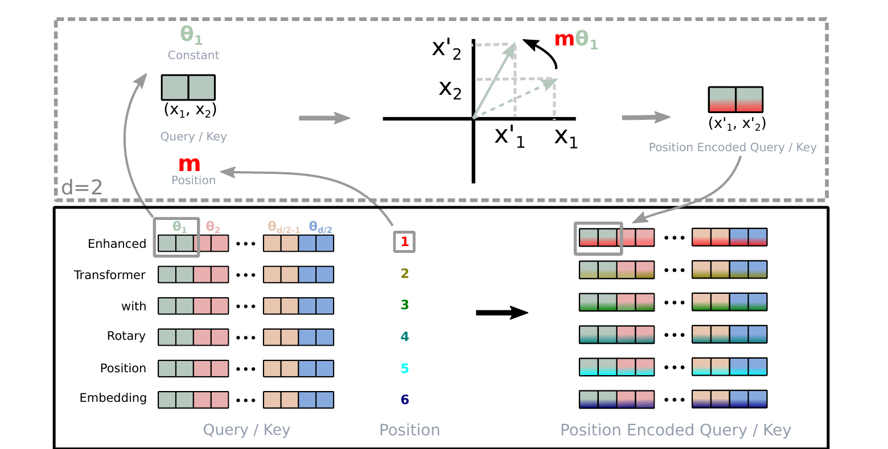

## 摘要

位置编码近来在 Transformer 架构中展现出有效性：它为序列中不同位置元素之间的依赖建模提供了有价值的监督信号。本文首先系统考察了将位置信息融入 Transformer 语言模型学习过程的各种方法，随后提出一种新方法——旋转位置嵌入（Rotary Position Embedding, RoPE）——以更有效地利用位置信息。具体而言，RoPE 用旋转矩阵编码绝对位置，同时在自注意力公式中显式引入相对位置依赖。值得注意的是，RoPE 具备若干有价值的性质：序列长度的灵活性、token 间依赖随相对距离增大而衰减，以及为线性自注意力配备相对位置编码的能力。最后，我们在多个长文本分类基准数据集上评估了使用旋转位置嵌入增强的 Transformer，即 RoFormer。实验表明，它稳定优于各类替代方案；我们同时给出理论分析以解释部分实验结果。RoFormer 已集成到 Hugging Face Transformers。

## 1 引言

词语的先后顺序对自然语言理解具有重要价值。基于循环神经网络（RNN）的模型沿时间维度递归地计算隐状态，从而把 token 的顺序编码进表示；基于卷积神经网络（CNN）的模型通常被认为与位置无关，但近期研究表明，常用的 padding 操作可以隐式学到位置信息。近年来，以 Transformer 为基础的预训练语言模型（PLM）在上下文表示学习、机器翻译、语言建模等众多 NLP 任务上取得了当时最好的性能。与 RNN、CNN 不同，PLM 依靠自注意力机制从语料中捕获上下文语义表示，因而在并行化程度上显著优于 RNN，并且相较单层 CNN 能更好地建模较长的 token 内部关系。

然而，现有 PLM 的自注意力架构本身被证明是与位置无关的：自注意力对输入顺序是置换等变的，如果不额外注入位置信息，模型无法区分不同词序。为把位置信息编码进学习过程，研究者提出了多种方案。一侧是绝对位置编码：或用预先定义的函数生成位置向量并加到上下文表示上（如正弦编码），或使用可训练的绝对位置向量（BERT、ALBERT、ELECTRA、GPT 等）。另一侧是相对位置编码：通常把相对位置信息编码进注意力机制（Shaw 等、Transformer-XL、XLNet、T5、DeBERTa 等）。除此之外，也有工作从 Neural ODE 的角度建模位置编码的依赖关系，或在复空间中建模位置信息。尽管这些方法各有成效，它们通常都把位置信息加到上下文表示上，因而无法直接用于线性自注意力架构。线性注意力通过核函数分解把注意力复杂度从 $O(N^2)$ 降到 $O(N)$，对长文本建模尤为重要；已有位置编码与它不兼容，这构成本文的直接动机之一。

本文提出一种新方法——旋转位置嵌入（RoPE），把位置信息注入 PLM 的学习过程。具体而言，RoPE 用旋转矩阵编码绝对位置，同时在自注意力公式中显式体现相对位置依赖。相比已有方法，RoPE 具备以下有价值的性质：序列长度的灵活性、token 间依赖随相对距离增大而衰减，以及为线性自注意力配备相对位置编码的能力。在多个长文本分类基准上的实验显示，使用 RoPE 增强的 Transformer（RoFormer）优于基线替代方案，验证了 RoPE 的有效性。

本文的贡献可以概括为三点：

1. **新的相对位置编码思路。** 我们梳理了已有的相对位置编码方法，发现它们大多建立在“把位置编码加到上下文表示上再做分解”的思路之上。我们提出 RoPE，用旋转矩阵乘以上下文表示来编码相对位置，并给出清晰的理论解释。
2. **性质分析。** 我们研究了 RoPE 的性质，证明其内积随相对距离增大而衰减——这正是自然语言编码所期望的；同时指出以往基于相对位置编码的方法与线性自注意力并不兼容。
3. **系统的实验评估。** 我们在多个长文本基准上评估 RoFormer，结果显示它稳定优于替代方案。部分预训练模型实验已开源于 GitHub。

全文组织如下：第 2 节给出自注意力架构中位置编码问题的形式化描述并回顾相关工作；第 3 节介绍 RoPE 并研究其性质；第 4 节报告实验；第 5 节总结。

## 2 背景与相关工作

### 2.1 预备知识

设 $S_N=\{w_i\}_{i=1}^{N}$ 是长度为 $N$ 的输入 token 序列，$w_i$ 为第 $i$ 个元素。其词嵌入记为 $E_N=\{\mathbf{x}_i\}_{i=1}^{N}$，其中 $\mathbf{x}_i\in\mathbb{R}^{d}$ 是 token $w_i$ 不含位置信息的 $d$ 维词嵌入。自注意力首先把位置信息注入词嵌入，再将其变换为 query、key 和 value 表示：

$$
\mathbf{q}_m = f_q(\mathbf{x}_m, m),\qquad
\mathbf{k}_n = f_k(\mathbf{x}_n, n),\qquad
\mathbf{v}_n = f_v(\mathbf{x}_n, n),
\tag{1}
$$

其中 $\mathbf{q}_m$、$\mathbf{k}_n$、$\mathbf{v}_n$ 分别通过 $f_q$、$f_k$、$f_v$ 融入了第 $m$、$n$ 个位置的信息。query 与 key 随后用于计算注意力权重，输出则是 value 表示的加权和：

$$
a_{m,n}=\frac{\exp\left(\mathbf{q}_m^\top\mathbf{k}_n/\sqrt{d}\right)}
{\sum_{j=1}^{N}\exp\left(\mathbf{q}_m^\top\mathbf{k}_j/\sqrt{d}\right)},
\qquad
\mathbf{o}_m=\sum_{n=1}^{N}a_{m,n}\mathbf{v}_n .
\tag{2}
$$

现有基于 Transformer 的位置编码方法，主要区别就在于为式 (1) 选取何种函数 $f$。

### 2.2 绝对位置嵌入

一种典型选择是

$$
f_{t}(x_i,i):=W_{t}\left(x_i+\mathbf{p}_i\right),\qquad t\in\{q,k,v\},
\tag{3}
$$

其中 $\mathbf{p}_i\in\mathbb{R}^{d}$ 是只依赖 token 位置的 $d$ 维向量。已有工作引入一组可训练向量 $\mathbf{p}_i\in\{\mathbf{p}_t\}_{t=1}^{L}$，$L$ 为最大序列长度。Vaswani 等则用正弦函数生成 $\mathbf{p}_i$：

$$
p_{i,2t}=\sin\left(i/10000^{2t/d}\right),\qquad
p_{i,2t+1}=\cos\left(i/10000^{2t/d}\right),
\tag{4}
$$

其中 $p_{i,2t}$ 是 $d$ 维向量 $\mathbf{p}_i$ 的第 $2t$ 个分量。后文将说明，RoPE 与这一正弦函数的直觉相关；区别在于 RoPE 不把位置直接加到上下文表示上，而是用正弦函数做乘法来注入相对位置信息。

绝对位置嵌入的优点是实现简单、与模型其余部分解耦；缺点则在于位置向量与最大序列长度绑定；对可训练方案而言，每个位置的表征还是独立学习的，因而难以在训练长度之外泛化。这一局限正是相对位置编码与本文方法的出发点。

### 2.3 相对位置嵌入

Shaw 等对式 (1) 作了如下设置：

$$
f_q(x_m):=W_q x_m,\quad
f_k(x_n,n):=W_k\left(x_n+\tilde{\mathbf{p}}_k^{r}\right),\quad
f_v(x_n,n):=W_v\left(x_n+\tilde{\mathbf{p}}_v^{r}\right),
\tag{5}
$$

其中 $\tilde{\mathbf{p}}_k^{r},\tilde{\mathbf{p}}_v^{r}\in\mathbb{R}^{d}$ 是可训练的相对位置嵌入，$r=\operatorname{clip}(m-n,r_{\min},r_{\max})$ 表示位置 $m$ 与 $n$ 的相对距离。他们对相对距离做截断，假设超过一定距离后精确的相对位置信息不再有用。

Dai 等保持式 (3) 的形式，把式 (2) 中的 $\mathbf{q}_m^\top\mathbf{k}_n$ 分解为

$$
\mathbf{q}_m^\top\mathbf{k}_n=
\mathbf{x}_m^\top W_q^\top W_k\mathbf{x}_n
+\mathbf{x}_m^\top W_q^\top W_k\mathbf{p}_n
+\mathbf{p}_m^\top W_q^\top W_k\mathbf{x}_n
+\mathbf{p}_m^\top W_q^\top W_k\mathbf{p}_n .
\tag{6}
$$

其核心想法是：把绝对位置嵌入 $\mathbf{p}_n$ 换成正弦编码的相对版本 $\tilde{\mathbf{p}}_{m-n}$，并把第三、四项中的绝对位置 $\mathbf{p}_m$ 换成两个与 query 位置无关的可训练向量 $\mathbf{u}$、$\mathbf{v}$；同时把内容相关的 key 与位置相关的 key 区分开，分别使用 $W_k$ 与 $W_{f_k}$：

$$
\mathbf{q}_m^\top\mathbf{k}_n=
\mathbf{x}_m^\top W_q^\top W_k\mathbf{x}_n
+\mathbf{x}_m^\top W_q^\top W_{f_k}\tilde{\mathbf{p}}_{m-n}
+\mathbf{u}^\top W_q^\top W_k\mathbf{x}_n
+\mathbf{v}^\top W_q^\top W_{f_k}\tilde{\mathbf{p}}_{m-n}.
\tag{7}
$$

注意这里通过令 $f_v(x_j):=W_v x_j$ 去掉了 value 项中的位置信息。后续工作（T5、DeBERTa 等）沿用了只把相对位置编码进注意力权重的设定。T5 把式 (6) 改写为

$$
\mathbf{q}_m^\top\mathbf{k}_n=\mathbf{x}_m^\top W_q^\top W_k\mathbf{x}_n+b_{m,n},
\tag{8}
$$

其中 $b_{m,n}$ 是可训练的偏置。另有工作用不同的投影矩阵分别建模词对与位置对，即

$$
\mathbf{q}_m^\top\mathbf{k}_n=
\mathbf{x}_m^\top W_q^\top W_k\mathbf{x}_n
+\mathbf{p}_m^\top U_q^\top U_k\mathbf{p}_n+b_{m,n}.
\tag{9}
$$

DeBERTa 则认为两个 token 的相对位置只能由式 (6) 的中间两项完整建模，于是直接把绝对位置嵌入 $\mathbf{p}_m$、$\mathbf{p}_n$ 替换为相对位置嵌入 $\tilde{\mathbf{p}}_{m-n}$：

$$
\mathbf{q}_m^\top\mathbf{k}_n=
\mathbf{x}_m^\top W_q^\top W_k\mathbf{x}_n
+\mathbf{x}_m^\top W_q^\top W_k\tilde{\mathbf{p}}_{m-n}
+\tilde{\mathbf{p}}_{m-n}^\top W_q^\top W_k\mathbf{x}_n .
\tag{10}
$$

对四种相对位置嵌入变体的比较表明，与式 (10) 相近的变体在四者中最为高效。总体而言，这些方法都是在式 (2) 的自注意力设定下修改式 (6)，而式 (6) 源自式 (3) 的加性分解：它们都把位置信息直接加到上下文表示上。本文则试图在若干约束下从式 (1) 出发推导相对位置编码，并通过旋转上下文表示来注入相对位置——这使其具有更好的可解释性。

这些方法的共同结构值得进一步强调。位置以加性方式进入 $\mathbf{x}_i$，再经 $W_q$、$W_k$ 投影，于是注意力分数是 $(\mathbf{x}_m+\mathbf{p}_m)$ 与 $(\mathbf{x}_n+\mathbf{p}_n)$ 的双线性函数；展开后会出现内容–内容、内容–位置、位置–内容、位置–位置四类交叉项，式 (6) 正是这一展开。相对位置方法本质上是在这四项上做取舍或重参数化。问题在于，线性注意力要求 $\operatorname{sim}(\mathbf{q}_m,\mathbf{k}_n)$ 能分解为只依赖 $m$ 与只依赖 $n$ 的两个因子之积，才能借结合律把复杂度降到 $O(N)$；加性位置项破坏了这种可分解性。本文的乘性形式则保留了它。

## 3 本文方法

本节讨论 RoPE：3.1 节形式化相对位置编码问题，3.2 节推导 RoPE，3.3 节研究其性质，3.4 节给出理论解释。

### 3.1 问题形式化

如式 (2) 所示，$\mathbf{q}_m^\top\mathbf{k}_n$ 承担着不同位置 token 之间的信息传递。为引入相对位置信息，我们要求 query $\mathbf{q}_m$ 与 key $\mathbf{k}_n$ 的内积能写成某个函数 $g$，且 $g$ 只以词嵌入 $\mathbf{x}_m$、$\mathbf{x}_n$ 及其相对位置 $m-n$ 为输入。换言之，我们希望内积仅以相对形式编码位置信息：

$$
\left\langle f_q(\mathbf{x}_m,m),\,f_k(\mathbf{x}_n,n)\right\rangle
= g(\mathbf{x}_m,\mathbf{x}_n,m-n).
\tag{11}
$$

最终目标是找到一种等价的编码机制，解出满足上述关系的 $f_q(\mathbf{x}_m,m)$ 与 $f_k(\mathbf{x}_n,n)$。相对位置的符号约定不影响结论：下文推导中 $g$ 取实值，把 $m-n$ 换成 $n-m$ 只会让相应的复指数取共轭，实部不变。

### 3.2 旋转位置嵌入

#### 3.2.1 二维情形

先从 $d=2$ 的简单情形入手。此时可利用二维平面上向量的几何性质及其复数形式证明（详见 3.4.1 节），式 (11) 的一个解为

$$
\begin{aligned}
f_q(\mathbf{x}_m,m)&=(W_q\mathbf{x}_m)\,e^{\mathrm{i}m\theta},\\
f_k(\mathbf{x}_n,n)&=(W_k\mathbf{x}_n)\,e^{\mathrm{i}n\theta},\\
g(\mathbf{x}_m,\mathbf{x}_n,m-n)&=\operatorname{Re}\left[(W_q\mathbf{x}_m)(W_k\mathbf{x}_n)^{*}e^{\mathrm{i}(m-n)\theta}\right],
\end{aligned}
\tag{12}
$$

其中 $\operatorname{Re}[\cdot]$ 取复数的实部，$(W_k\mathbf{x}_n)^{*}$ 表示 $W_k\mathbf{x}_n$ 的共轭，$\theta\in\mathbb{R}$ 是预先设定的非零常数。进一步可把 $f_{\{q,k\}}$ 写成矩阵乘法：

$$
f_{\{q,k\}}(\mathbf{x}_m,m)=
\begin{pmatrix}
\cos m\theta & -\sin m\theta\\
\sin m\theta & \cos m\theta
\end{pmatrix}
W_{\{q,k\}}\mathbf{x}_m .
\tag{13}
$$

于是，注入相对位置嵌入变得非常直接：只需把仿射变换后的词嵌入向量按其位置序号的倍数角度旋转。这正是“旋转位置嵌入”这一名称背后的直觉。

#### 3.2.2 一般形式

为把二维结果推广到任意偶数维 $\mathbf{x}_i\in\mathbb{R}^{d}$，我们把 $d$ 维空间划分为 $d/2$ 个子空间，并利用内积的线性性质把它们组合起来，得到

$$
f_{\{q,k\}}(\mathbf{x}_m,m)=R^{d}_{\Theta,m}W_{\{q,k\}}\mathbf{x}_m,
\tag{14}
$$

其中

$$
R^{d}_{\Theta,m}=
\begin{pmatrix}
\cos m\theta_1 & -\sin m\theta_1 & 0 & 0 & \cdots & 0 & 0\\
\sin m\theta_1 & \cos m\theta_1 & 0 & 0 & \cdots & 0 & 0\\
0 & 0 & \cos m\theta_2 & -\sin m\theta_2 & \cdots & 0 & 0\\
0 & 0 & \sin m\theta_2 & \cos m\theta_2 & \cdots & 0 & 0\\
\vdots & \vdots & \vdots & \vdots & \ddots & \vdots & \vdots\\
0 & 0 & 0 & 0 & \cdots & \cos m\theta_{d/2} & -\sin m\theta_{d/2}\\
0 & 0 & 0 & 0 & \cdots & \sin m\theta_{d/2} & \cos m\theta_{d/2}
\end{pmatrix}
\tag{15}
$$

是带预定义参数 $\Theta=\{\theta_i=10000^{-2(i-1)/d},\ i=1,\dots,d/2\}$ 的旋转矩阵。图 1 给出了 RoPE 的直观示意。把 RoPE 应用于式 (2) 的自注意力，得到

$$
\mathbf{q}_m^\top\mathbf{k}_n=
\left(R^{d}_{\Theta,m}W_q\mathbf{x}_m\right)^\top
\left(R^{d}_{\Theta,n}W_k\mathbf{x}_n\right)
=\mathbf{x}_m^\top W_q^\top R^{d}_{\Theta,n-m}W_k\mathbf{x}_n,
\tag{16}
$$

其中 $R^{d}_{\Theta,n-m}=\left(R^{d}_{\Theta,m}\right)^\top R^{d}_{\Theta,n}$。注意 $R^{d}_{\Theta}$ 是正交矩阵，这保证了位置编码过程中的数值稳定性。此外，$R^{d}_{\Theta}$ 高度稀疏，直接按式 (16) 做矩阵乘法并不高效；3.4.2 节给出另一种实现。

从式 (15) 可以看出，$R^{d}_{\Theta,m}$ 是分块对角矩阵，每个 $2\times 2$ 块只作用于一对相邻维度。因此 RoPE 并不是在 $d$ 维空间里做一次整体旋转，而是在 $d/2$ 个相互正交的二维平面内分别旋转：第 $i$ 个平面的旋转角为 $m\theta_i$，频率 $\theta_i$ 随维度指数衰减。这种多频率设计使不同维度对相对距离的敏感度不同——高频维度区分近距离，低频维度承载长程信息，这正是后文远程衰减性质的来源。

与以往工作采用的加性位置嵌入（式 (3)–(10)）不同，本文方法是乘性的。并且，RoPE 通过旋转矩阵乘积自然地引入相对位置信息，而不是去改动加性位置编码展开式中的某一项。

### 3.3 RoPE 的性质

RoPE 具有以下四条值得关注的性质。

- **相对位置依赖。** 由式 (16)，$\mathbf{q}_m^\top\mathbf{k}_n$ 只通过 $n-m$ 依赖位置，绝对位置被旋转矩阵“吸收”，注意力分数天然具有相对形式。
- **序列长度灵活性。** 旋转角只由位置序号和预设频率决定，不引入与最大序列长度绑定的可训练参数；同一套参数可以处理训练时未见过的更长序列。需要说明的是，这是结构层面的灵活性，它为长度外推提供了基础，但并不自动保证任意更长序列上的性能。
- **远程衰减。** 按 Vaswani 等的设置取 $\theta_i=10000^{-2i/d}$ 时，内积会随相对距离增大而衰减（详见 3.4.3 节）。这与“相对距离较远的 token 对之间联系应更弱”的直觉一致。
- **与线性注意力兼容。** 旋转不改变隐表示的范数，因此 RoPE 可以直接乘在非线性函数的输出上，用于线性自注意力。

把式 (16) 与式 (3) 对比，可以看到一个关键差别：绝对位置编码把 $\mathbf{p}_m$、$\mathbf{p}_n$ 加到表示上，位置信息进入的是双线性型的多个交叉项；RoPE 则让旋转矩阵夹在 $W_q$ 与 $W_k$ 之间，并利用正交性合并为单个 $R^{d}_{\Theta,n-m}$。因此位置只以相对形式出现，也不引入额外的加性项。这四条性质中，相对依赖与长度灵活性关乎“能否用”，远程衰减与线性注意力兼容关乎“用得好不好”。

**线性注意力下的 RoPE。** 自注意力可以写成更一般的形式：

$$
\operatorname{Attention}(Q,K,V)_m=
\frac{\sum_{n=1}^{N}\operatorname{sim}(\mathbf{q}_m,\mathbf{k}_n)\mathbf{v}_n}
{\sum_{n=1}^{N}\operatorname{sim}(\mathbf{q}_m,\mathbf{k}_n)}.
\tag{17}
$$

原始自注意力取 $\operatorname{sim}(\mathbf{q}_m,\mathbf{k}_n)=\exp(\mathbf{q}_m^\top\mathbf{k}_n/\sqrt{d})$，需要为每一对 token 计算内积，复杂度为 $O(N^2)$。线性注意力把式 (17) 改写为

$$
\operatorname{Attention}(Q,K,V)_m=
\frac{\sum_{n=1}^{N}\phi(\mathbf{q}_m)^\top\varphi(\mathbf{k}_n)\mathbf{v}_n}
{\sum_{n=1}^{N}\phi(\mathbf{q}_m)^\top\varphi(\mathbf{k}_n)},
\tag{18}
$$

其中 $\phi(\cdot)$、$\varphi(\cdot)$ 通常是非负函数。Katharopoulos 等取 $\phi(x)=\varphi(x)=\mathrm{elu}(x)+1$，并利用矩阵乘法的结合律先计算 key 与 value 的乘积；Shen 等则在内积之前用 softmax 分别归一化 query 与 key，等价于 $\phi(\mathbf{q}_i)=\mathrm{softmax}(\mathbf{q}_i)$、$\varphi(\mathbf{k}_j)=\exp(\mathbf{k}_j)$。

由于 RoPE 通过旋转注入位置信息且保持隐表示范数不变，我们可以把旋转矩阵乘在非负函数的输出上，从而把 RoPE 与线性注意力结合：

$$
\operatorname{Attention}(Q,K,V)_m=
\frac{\sum_{n=1}^{N}\left(R^{d}_{\Theta,m}\phi(\mathbf{q}_m)\right)^\top
\left(R^{d}_{\Theta,n}\varphi(\mathbf{k}_n)\right)\mathbf{v}_n}
{\sum_{n=1}^{N}\phi(\mathbf{q}_m)^\top\varphi(\mathbf{k}_n)}.
\tag{19}
$$

注意分母保持不变，以避免除零风险；分子中的求和可能包含负项。因此式 (19) 对各个 $\mathbf{v}_i$ 的权重并非严格概率归一化，但我们认为该计算仍能建模 value 的重要性。

### 3.4 理论解释

#### 3.4.1 二维下 RoPE 的推导

在 $d=2$ 的情形下，考虑分别对应 query 与 key 的两个词嵌入向量 $\mathbf{x}_q$、$\mathbf{x}_k$，其位置为 $m$ 与 $n$。按式 (1)，位置编码后的对应量为

$$
\mathbf{q}_m=f_q(\mathbf{x}_q,m),\qquad
\mathbf{k}_n=f_k(\mathbf{x}_k,n).
\tag{20}
$$

假设存在函数 $g$ 定义 $f_{\{q,k\}}$ 输出之间的内积：

$$
\mathbf{q}_m^\top\mathbf{k}_n=
\left\langle f_q(\mathbf{x}_q,m),f_k(\mathbf{x}_k,n)\right\rangle
=g(\mathbf{x}_q,\mathbf{x}_k,n-m),
\tag{21}
$$

并要求满足初始条件

$$
\mathbf{q}=f_q(\mathbf{x}_q,0),\qquad
\mathbf{k}=f_k(\mathbf{x}_k,0),
\tag{22}
$$

即位置信息为空时的向量。下面求解 $f_q$、$f_k$。利用二维向量的几何意义及其复数形式，把式 (20)、(21) 分解为

$$
\begin{aligned}
f_q(\mathbf{x}_q,m)&=R_q(\mathbf{x}_q,m)e^{\mathrm{i}\Theta_q(\mathbf{x}_q,m)},\\
f_k(\mathbf{x}_k,n)&=R_k(\mathbf{x}_k,n)e^{\mathrm{i}\Theta_k(\mathbf{x}_k,n)},\\
g(\mathbf{x}_q,\mathbf{x}_k,n-m)&=R_g(\mathbf{x}_q,\mathbf{x}_k,n-m)e^{\mathrm{i}\Theta_g(\mathbf{x}_q,\mathbf{x}_k,n-m)},
\end{aligned}
\tag{23}
$$

其中 $R$ 与 $\Theta$ 分别为模长与辐角。代入式 (21) 得

$$
R_q(\mathbf{x}_q,m)R_k(\mathbf{x}_k,n)=R_g(\mathbf{x}_q,\mathbf{x}_k,n-m),\qquad
\Theta_k(\mathbf{x}_k,n)-\Theta_q(\mathbf{x}_q,m)=\Theta_g(\mathbf{x}_q,\mathbf{x}_k,n-m).
\tag{24}
$$

这里的关键是把二维向量看成复数：模长对应向量长度，辐角对应方向。若位置编码只改变方向而不改变长度，内积的模长部分就与位置无关，位置信息完全由辐角差承载。这一观察直接导向“旋转”的解释。

在式 (24) 中令 $m=n$，并结合初始条件，有

$$
R_q(\mathbf{x}_q,m)R_k(\mathbf{x}_k,m)=\lVert\mathbf{q}\rVert\lVert\mathbf{k}\rVert,\qquad
\Theta_k(\mathbf{x}_k,m)-\Theta_q(\mathbf{x}_q,m)=\theta_k-\theta_q .
\tag{25}
$$

由式 (25) 可知，模长函数与位置无关，可直接取 $R_q=\lVert\mathbf{q}\rVert$、$R_k=\lVert\mathbf{k}\rVert$；而 $\Theta_q(\mathbf{x}_q,m)-\theta_q=\Theta_k(\mathbf{x}_k,m)-\theta_k$ 说明辐角函数不依赖 query 或 key 的具体内容。令该差值为仅与位置 $m$ 有关的 $\varphi(m)$，则

$$
\Theta_f(\mathbf{x}_{\{q,k\}},m)=\varphi(m)+\theta_{\{q,k\}}.
\tag{26}
$$

再把 $n=m+1$ 代入式 (24)，可得 $\varphi(m+1)-\varphi(m)=\Theta_g(\mathbf{x}_q,\mathbf{x}_k,1)+\theta_q-\theta_k$。右端与 $m$ 无关，因此连续整数输入下的 $\varphi(m)$ 构成等差数列：

$$
\varphi(m)=m\theta+\gamma,
\tag{27}
$$

其中 $\theta,\gamma\in\mathbb{R}$ 为常数且 $\theta\neq 0$。综合以上结果：

$$
f_q(\mathbf{x}_q,m)=\lVert\mathbf{q}\rVert e^{\mathrm{i}(\theta_q+m\theta+\gamma)}=\mathbf{q}\,e^{\mathrm{i}(m\theta+\gamma)},\qquad
f_k(\mathbf{x}_k,n)=\mathbf{k}\,e^{\mathrm{i}(n\theta+\gamma)}.
\tag{28}
$$

由于式 (22) 未对 $f_q$、$f_k$ 施加额外约束，$f_q(\mathbf{x}_m,0)$ 与 $f_k(\mathbf{x}_n,0)$ 可自由选取。为与式 (3) 对齐，取 $\mathbf{q}=f_q(\mathbf{x}_m,0)=W_q\mathbf{x}_m$、$\mathbf{k}=f_k(\mathbf{x}_n,0)=W_k\mathbf{x}_n$，并令 $\gamma=0$，最终得到

$$
f_q(\mathbf{x}_m,m)=(W_q\mathbf{x}_m)e^{\mathrm{i}m\theta},\qquad
f_k(\mathbf{x}_n,n)=(W_k\mathbf{x}_n)e^{\mathrm{i}n\theta}.
\tag{29}
$$

这正是 3.2.1 节给出的二维解。

#### 3.4.2 高效实现

利用式 (15) 中 $R^{d}_{\Theta,m}$ 的稀疏性，$R^{d}_{\Theta}$ 与 $\mathbf{x}\in\mathbb{R}^{d}$ 相乘可以更高效地实现：

$$
R^{d}_{\Theta,m}\mathbf{x}=
\begin{pmatrix}x_1\\x_2\\x_3\\x_4\\\vdots\\x_{d-1}\\x_d\end{pmatrix}
\odot
\begin{pmatrix}\cos m\theta_1\\ \cos m\theta_1\\ \cos m\theta_2\\ \cos m\theta_2\\ \vdots\\ \cos m\theta_{d/2}\\ \cos m\theta_{d/2}\end{pmatrix}
+
\begin{pmatrix}-x_2\\x_1\\-x_4\\x_3\\\vdots\\-x_d\\x_{d-1}\end{pmatrix}
\odot
\begin{pmatrix}\sin m\theta_1\\ \sin m\theta_1\\ \sin m\theta_2\\ \sin m\theta_2\\ \vdots\\ \sin m\theta_{d/2}\\ \sin m\theta_{d/2}\end{pmatrix},
\tag{30}
$$

其中 $\odot$ 为逐元素乘法。按此实现，整个旋转只需两次逐元素乘法与一次逐元素加法，整体开销为 $O(d)$，且无需显式构造 $d\times d$ 的稀疏矩阵。实际工程中通常把向量的相邻两维配对，预先缓存各位置的 $\cos m\theta_i$ 与 $\sin m\theta_i$，再以逐元素运算完成旋转；这也是 RoPE 在大模型中易于落地的原因之一。

#### 3.4.3 远程衰减

把 $\mathbf{q}=W_q\mathbf{x}_m$ 与 $\mathbf{k}=W_k\mathbf{x}_n$ 的分量两两分组，式 (16) 中的内积可以写成复数乘法：

$$
\left(R^{d}_{\Theta,m}W_q\mathbf{x}_m\right)^\top
\left(R^{d}_{\Theta,n}W_k\mathbf{x}_n\right)
=\operatorname{Re}\left[\sum_{i=0}^{d/2-1}
\mathbf{q}^{[2i:2i+1]}\left(\mathbf{k}^{[2i:2i+1]}\right)^{*}
e^{\mathrm{i}(m-n)\theta_i}\right],
\tag{31}
$$

其中 $\mathbf{q}^{[2i:2i+1]}$ 表示 $\mathbf{q}$ 的第 $2i$ 到第 $2i+1$ 个分量。记 $h_i=\mathbf{q}^{[2i:2i+1]}(\mathbf{k}^{[2i:2i+1]})^{*}$、$S_j=\sum_{i=0}^{j-1}e^{\mathrm{i}(m-n)\theta_i}$，并令 $h_{d/2}=0$、$S_0=0$，用阿贝尔变换可得

$$
\sum_{i=0}^{d/2-1}h_i e^{\mathrm{i}(m-n)\theta_i}
=-\sum_{i=0}^{d/2-1}S_{i+1}\left(h_{i+1}-h_i\right).
\tag{32}
$$

取绝对值即得上界：

$$
\left|\sum_{i=0}^{d/2-1}h_i e^{\mathrm{i}(m-n)\theta_i}\right|
\le \max_i\left|h_{i+1}-h_i\right|\sum_{i=0}^{d/2-1}\left|S_{i+1}\right|.
\tag{33}
$$

当取 $\theta_i=10000^{-2i/d}$（与式 (15) 相差一个下标平移）时，$\frac{1}{d/2}\sum_{i=1}^{d/2}|S_i|$ 随相对距离 $|m-n|$ 的增大而衰减（论文图 2）。也就是说，内积的上界随相对距离增大而下降，这与自然语言中“相距较远的 token 关联更弱”的直觉吻合。

阿贝尔变换在这里的作用，是把“对振荡项的求和”转成“对部分和的加权”，从而把衰减归因于部分和 $S_j$ 随距离增大而相互抵消。频率按几何级数排列时，不同频率的相位差随 $|m-n|$ 增长而分散，这种抵消在整体上更充分，于是得到与距离相关的上界。

## 4 实验与评估

我们在多种 NLP 任务上评估 RoFormer：4.1 节验证机器翻译；4.2 节在预训练阶段把 RoPE 与 BERT 对比；4.3 节基于预训练模型在 GLUE 下游任务上评估；4.4 节把 RoPE 用于 Performer 的线性注意力；4.5 节补充中文数据实验。所有实验运行在两台各配 4 块 V100 GPU 的云服务器上。

### 4.1 机器翻译

我们首先在序列到序列的机器翻译任务上考察 RoFormer。选用标准的 WMT 2014 英德数据集，约 450 万句对，基线为 Vaswani 等的 Transformer。

**实现细节。** 我们修改基线模型的自注意力层以接入 RoPE，沿用英德翻译的设置，源语言与目标语言共享 37k 词表的 BPE。评估时对最后 5 个 checkpoint 取平均得到单一模型，解码使用 beam size 为 4、长度惩罚 0.6 的 beam search。实验在 fairseq 工具包中用 PyTorch 实现；优化器为 Adam（$\beta_1=0.9$、$\beta_2=0.98$），学习率从 $1\times10^{-7}$ 线性升至 $5\times10^{-4}$，随后按步数平方根的倒数衰减，并使用 0.1 的标签平滑。最终指标为测试集 BLEU。

**结果。** 在完全相同的设置下训练基线模型与 RoFormer，结果见表 1。

表 1：WMT 2014 英德翻译任务上 RoFormer 与 Transformer 基线的 BLEU 对比。
{: .table-caption #tab-1 }

| 模型 | BLEU |
| --- | :---: |
| Transformer-base（Vaswani 等） | 27.3 |
| RoFormer | **27.5** |

RoFormer 取得了略高于基线的 BLEU。提升幅度不大，但方向一致：在相同的参数量与训练预算下，仅把正弦位置编码替换为 RoPE 就能带来收益。机器翻译对词序敏感，但训练与测试的序列长度相对有限，正弦编码本身已能提供相当充分的位置信号，因此 RoPE 的收益主要表现为小幅而稳定的提升；它的优势更多出现在更长序列与线性注意力场景。

### 4.2 预训练语言建模

第二个实验检验 RoPE 在学习上下文表示方面的表现：在预训练阶段用 RoPE 替换 BERT 原有的正弦位置编码。

**实验设置。** 预训练语料为 BookCorpus 与 Wikipedia（来自 Hugging Face Datasets，Apache License 2.0），按 8:2 划分为训练集与验证集。以训练过程中的掩码语言建模（MLM）损失作为评价指标，基线为 bert-base-uncased。

**实现细节。** 我们把基线模型自注意力块中的正弦位置编码替换为 RoPE，并按式 (16) 实现自注意力。BERT 与 RoFormer 均以 batch size 64、最大序列长度 512 训练 100k 步，优化器为 AdamW，学习率 $1\times10^{-5}$。

**结果。** 预训练 MLM 损失曲线（论文图 3 左）显示，相比原始 BERT，RoFormer 在相同训练步数下损失更低、收敛更快。这说明 RoPE 不仅提供了位置信号，也有助于优化过程更早进入较好的区域。

### 4.3 GLUE 微调

沿用上述预训练权重，我们在多个 GLUE 任务上微调 RoFormer，以评估其在下游 NLP 任务上的泛化能力。

**实验设置。** 选取 MRPC、SST-2、QNLI、STS-B、QQP 与 MNLI。MRPC 与 QQP 使用 F1，STS-B 使用 Spearman 相关系数，其余使用准确率。

**实现细节。** 使用 Hugging Face Transformers 对每个下游任务微调 3 个 epoch，最大序列长度 512，batch size 32，学习率在 $2,3,4,5\times10^{-5}$ 中选取；按 BERT 的惯例报告验证集上的最佳平均结果。

**结果。** 见表 2。

表 2：在 GLUE 下游任务上微调 RoFormer 与 BERT 的对比。MRPC/QQP 为 F1，STS-B 为 Spearman 相关系数，其余为准确率。
{: .table-caption #tab-2 }

| 模型 | MRPC | SST-2 | QNLI | STS-B | QQP | MNLI(m/mm) |
| --- | :---: | :---: | :---: | :---: | :---: | :---: |
| BERT | 88.9 | 93.5 | 90.5 | 85.8 | 71.2 | 84.6/83.4 |
| RoFormer | **89.5** | 90.7 | 88.0 | **87.0** | **86.4** | 80.2/79.8 |

RoFormer 在六个数据集中的三个上优于 BERT：MRPC 高 0.6，STS-B 高 1.2，QQP 高 15.2；但在 SST-2、QNLI 与 MNLI 上低于 BERT。需要指出，这里的预训练预算（100k 步、序列长度 512）远小于 BERT 原文，且各任务只做了少量超参搜索，因此表 2 更适合解读为“RoPE 在若干任务上具有竞争力”，而非全面的性能结论。论文原文的表述是：RoFormer 在六个数据集中的三个上显著优于 BERT，提升相当可观。

三处提升与三处下降并存，说明 RoPE 并非在所有下游任务上都占优。一种合理的解读是不同任务对位置信息的依赖程度不同：句对匹配、语义相似度这类任务更依赖词序与相对结构，而自然语言推断可能更依赖词汇与句法线索。当然，这一解释仍需更系统的消融实验支持。

### 4.4 结合 RoPE 的 Performer

Performer 引入线性注意力作为替代注意力机制，旨在避免随输入序列长度二次增长的计算开销。如 3.3 节所述，RoPE 可以方便地用于 Performer，在保持线性复杂度的同时实现相对位置编码。我们以语言建模预训练任务展示其效果。

**实现细节。** 在 Enwik8 数据集上实验。该数据集来自英文维基百科，除英文正文外还包含标记、特殊字符与其他语言的文本。我们把 RoPE 接入 12 层、768 维、12 个头的字符级 Performer。为更清楚地展示 RoPE 的作用，在相同设置下（学习率 $1\times10^{-4}$、batch size 128、固定最大序列长度 1024 等）对比使用与不使用 RoPE 的预训练损失曲线。

**结果。** 论文图 3 右显示，在相同训练步数下，把 RoPE 换入 Performer 带来更快的收敛与更低的损失。结合其线性复杂度，这一改进使 Performer 更具吸引力。

### 4.5 中文数据评估

除英文数据外，我们还给出中文数据上的结果。为验证 RoFormer 在长文本上的表现，实验使用的长文档长度超过 512 个字符。

长文档任务的关键在于：位置编码能否在超过预训练长度的输入上保持区分度。CAIL2019-SCM 的案例描述大多超过 512 字符，正好提供了这样的检验；同时，中文缺少天然空格，词级分词本身也引入了额外的粒度选择问题。

**实现。** 我们在 WoBERT 基础上做修改，把绝对位置嵌入替换为 RoPE。作为横向对比，表 3 列出若干中文预训练 Transformer 模型的分词粒度与位置嵌入方式：BERT 为字符级 + 绝对位置，WoBERT 为词级 + 绝对位置，NEZHA 为字符级 + 相对位置，RoFormer 为词级 + RoPE。

表 3：中文预训练模型在分词粒度与位置嵌入方式上的对比。“abs.” 与 “rel.” 分别表示绝对位置嵌入与相对位置嵌入。
{: .table-caption #tab-3 }

| 模型 | BERT | WoBERT | NEZHA | RoFormer |
| --- | :---: | :---: | :---: | :---: |
| 分词粒度 | 字 | 词 | 字 | 词 |
| 位置嵌入 | abs. | abs. | rel. | RoPE |

**预训练。** 预训练数据约 34GB，来自中文维基百科、新闻与论坛。预训练分多个阶段进行，各阶段改变 batch size 与最大输入序列长度，以使模型适应不同场景。如表 4 所示，随着序列长度上界提高，RoFormer 的准确率随之上升，体现了其处理长文本的能力；我们认为这归功于 RoPE 良好的泛化性。

表 4：RoFormer 在中文数据上的多阶段预训练策略。每个阶段使用特定的最大序列长度与 batch size 组合。
{: .table-caption #tab-4 }

| 阶段 | 最大序列长度 | Batch size | 训练步数 | 损失 | 准确率 |
| :---: | :---: | :---: | :---: | :---: | :---: |
| 1 | 512 | 256 | 200k | 1.73 | 65.0% |
| 2 | 1536 | 256 | 12.5k | 1.61 | 66.8% |
| 3 | 256 | 256 | 120k | 1.75 | 64.6% |
| 4 | 128 | 512 | 80k | 1.83 | 63.4% |
| 5 | 1536 | 256 | 10k | 1.58 | 67.4% |
| 6 | 512 | 512 | 30k | 1.66 | 66.2% |

**下游任务与数据。** 选用中文法律 AI 2019 相似案例匹配（CAIL2019-SCM）数据集来展示 RoFormer 处理长文本（语义文本匹配）的能力。该数据集包含 8964 个由最高人民法院公布的案例三元组，输入 $(A,B,C)$ 为三个案件的事实描述，任务是判断在预定义相似度度量下 $(A,B)$ 是否比 $(A,C)$ 更接近。由于文档较长（大多超过 512 字符），现有方法在该数据集上大多难以取得显著效果。我们按 6:2:2 划分训练、验证与测试集。

**结果。** 我们以不同输入长度把预训练 RoFormer 应用于 CAIL2019-SCM，并与在相同预训练数据上训练的 BERT、WoBERT 比较，结果见表 5。在 512 截断的短文本设置下，RoFormer 与 WoBERT 相当，略优于 BERT；把最大输入长度提升到 1024 后，RoFormer 相对 WoBERT 有明显提升（测试集 69.79% 对 68.10%，约 1.7 个百分点）。

表 5：CAIL2019-SCM 任务上的实验结果。第一列数字为最大截断序列长度，指标为准确率。
{: .table-caption #tab-5 }

| 模型 | 验证集 | 测试集 |
| --- | :---: | :---: |
| BERT-512 | 64.13% | 67.77% |
| WoBERT-512 | 64.07% | 68.10% |
| RoFormer-512 | 64.13% | 68.29% |
| RoFormer-1024 | **66.07%** | **69.79%** |

**局限性。** 尽管我们给出了理论依据与有希望的实验证据，本方法仍受以下事实限制。其一，虽然我们在数学上把相对位置关系表述为二维子空间中的旋转，但尚缺乏对“为何它比采用其他位置编码的基线收敛更快”的透彻解释。其二，虽然我们证明了模型在 token 内积上具有远程衰减性质（3.3 节），且模型在长文本上优于同类模型，但我们尚未给出令人信服的解释。此外，RoFormer 建立在 Transformer 基础设施之上，预训练需要相应的硬件资源。

## 5 结论

本文提出一种新的位置嵌入方法，在自注意力中显式引入相对位置依赖，以增强 Transformer 架构的性能。理论分析表明，相对位置可以用自注意力中的向量乘积自然地表述，而绝对位置信息通过旋转矩阵编码。我们还从数学上说明了该方法应用于 Transformer 时的若干优良性质。最后，英文与中文基准数据集上的实验表明，该方法在预训练中带来更快的收敛，并在长文本任务上取得更好的性能。

RoPE 的意义不止于当时的实验指标：它把“位置”从加在表示上的偏置变成了作用于表示的旋转，使注意力分数只依赖相对距离，同时不引入额外参数、不破坏线性注意力的结构。这一设计后来成为大语言模型位置编码的主流选择，并催生了围绕频率缩放与长度外推的一系列后续工作。

从今天的视角看，RoPE 提供的是一组可组合的原语：频率基可以缩放，旋转可以分块或只作用于部分维度，位置可以插值或外推。这些后续变体大多保留了式 (14)–(16) 的基本形式，只是在 $\Theta$ 的取值和施加范围上做文章。这也解释了为何 RoPE 能跨越模型规模与架构变化，长期作为位置编码的默认选择。

## 延伸阅读

- [DeepSeek-V2](../deepseek-v2/index.html)：DeepSeek 系列模型的技术报告，其核心贡献之一是 MLA（多头潜变量注意力），展示了如何在推理时压缩 KV 缓存。
- [TransMLA](../transmla/index.html)：研究如何把已训练好的 GQA 模型转换为 MLA 结构，以在推理阶段获得更低的 KV 缓存开销。
- [BidKV](../bidkv/index.html)：面向在线 LLM 服务的 KV 缓存回收策略，用效用排序选择被抢占的请求，与位置编码同属长上下文推理的基础设施问题。
