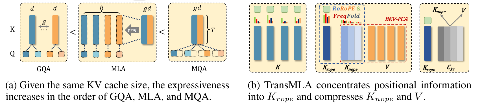
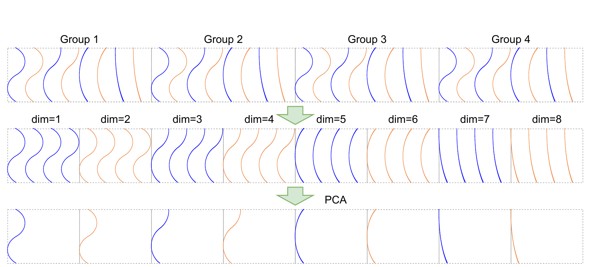

## 摘要

现代大语言模型在当前硬件上遇到的往往不是计算能力上限，而是通信瓶颈。多头潜变量注意力（MLA）用低秩矩阵压缩键值缓存，并通过 Absorb 操作避免推理时 KV 缓存回退到原始大小，从而同时提升训练与推理速度。尽管 DeepSeek V2/V3/R1 取得了成功，多数模型厂商已在 GQA 模型上投入大量优化，因而缺乏从零重训 MLA 模型的动力。本文证明：在相同 KV 缓存开销下，MLA 的表达能力强于 GQA，从而为从 GQA 转向 MLA 提供了依据。我们还提出 TransMLA，一个能把任意 GQA 预训练模型（如 LLaMA、Qwen、Gemma、Mistral/Mixtral）无缝转换为 MLA 模型的框架。该方法首次让这些模型可以直接转换为与 DeepSeek 代码库兼容的格式，从而充分利用 vLLM、SGLang 等 DeepSeek 特定优化。在 LLaMA-2-7B 上压缩 93% 的 KV 缓存后，我们在 8K 上下文下取得 10.6 倍加速，同时保持有意义的输出；此外，模型只需 6B token 的微调，就能在多个基准上恢复到可比性能。TransMLA 为 GQA 模型迁移到 MLA 结构提供了实用路径；结合 FP8 量化、多 token 预测（MTP）等 DeepSeek 高级优化，还可进一步加速推理。

## 1 引言

大语言模型（LLM）正在快速演进，但推理成本并没有随参数规模同步下降。自回归生成逐个 token 进行，每一步都要对全部历史 token 计算自注意力；为避免重复计算，实现会把历史 token 的键值（KV）对保存在缓存中。随着模型变大、上下文变长，KV 缓存本身逐渐成为推理的主要瓶颈：它随序列长度线性增长，占用大量显存，并限制批大小与并发度。换句话说，问题常常不是“算不动”，而是“搬不动、存不下”。

为缓解这一矛盾，分组查询注意力（GQA）把 query 头分组，每组共享一个 key/value 头。当组数为 1 时，GQA 退化为多查询注意力（MQA）；当组数等于头数时，它退化为标准多头注意力（MHA）。GQA 与 MQA 都以一定的模型质量为代价换取更小的 KV 缓存。另一条路线是训练后的 KV 缓存压缩，例如 Duo-Attention、KiVi、KV-Quant、H2O 等；这些方法能进一步降低显存占用，但往往依赖非标准实现和专门优化的算子，难以被广泛采用。

多头潜变量注意力（MLA）由 DeepSeek V2 提出，并在 DeepSeek V3 与 R1 中继续完善。它把 KV 缓存压缩到一个低秩潜向量中，在训练阶段保持接近 MHA 的并行计算形式，在推理阶段则通过 Absorb 操作切换为类似 MQA 的形式，从而在计算效率与模型质量之间取得很好的平衡。配备 MLA 的模型取得了当时最好的结果，同时把训练和推理成本压到新低；DeepSeek 团队持续开源的实现与部署方案，也让这些优化更容易被社区使用。

本文首先证明：在相同的 KV 缓存开销下，MLA 的表达能力严格强于 GQA。这为“为什么 MLA 值得用”提供了理论解释。但现实中的障碍不在理论，而在沉没成本：大多数厂商已经在 GQA 模型上投入了大量预训练与工程优化，不可能轻易推倒重来。于是本文追问：能否把一个已有的 GQA 预训练模型（如 LLaMA、Qwen）无缝转换为 MLA，从而继承原有权重与预训练成果，而不是从零训练一个 MLA 模型？

把 GQA 转成 MLA 的关键障碍是 RoPE。在 GQA 中，每个 query–key 头都携带自己的旋转位置嵌入（RoPE），而 DeepSeek 的 Absorb 操作要求 key 的上投影可以被吸收进 query 投影；只要每个头各自持有 RoPE，这一吸收就无法成立。借鉴 DeepSeek 的解耦 RoPE 方案，本文把 key 中的位置信号集中到一小部分维度 $K_{rope}$，其余维度 $K_{nope}$ 几乎不含位置信息。随后丢弃 $K_{nope}$ 上的 RoPE，把它与 value 合并后做低秩分解。一旦 RoPE 被隔离，key 的上投影就不再含位置变换，可以像 DeepSeek 那样被吸收进 query 投影，MLA 转换因此得以成立。

要把位置信息高效地集中到少数维度，本文提出 RoRoPE：对 key 输出做主成分分析（PCA），对 RoPE 的实部与虚部施加同一个旋转，并把所有注意力头的主成分合并到第一个头的维度中。作者证明：用矩阵 $U$ 同时旋转 query 与 key 时，只要满足两个条件，内积就保持不变——旋转只发生在所有头中相同的维度上，且 RoPE 的实部与虚部以相同方式旋转。进一步地，利用相邻 RoPE 维度频率相近的特点，本文提出 FreqFold，把多个相邻频率合并为一组再做联合 PCA，从而提高第一个头对位置信息的集中效率。

最后，作者观察到 $K_{nope}$ 的 $\ell_2$ 范数远大于 value 的范数。若直接对拼接矩阵 $[K_{nope};V]$ 做 PCA，主成分会被 key 主导，value 子空间的信息严重丢失，精度随之骤降。为此本文引入平衡键值（BKV）过程：先重新缩放 $K_{nope}$ 与 $V$，使二者范数匹配，再做联合 PCA。这个看似简单的归一化恢复了两个子空间之间的平衡，显著改善了压缩质量。

上述步骤合起来构成 TransMLA。在 LLaMA-2 7B 上，TransMLA 把 KV 缓存压缩 68.75%，在不训练的情况下六项基准平均分仅下降 1.65 分；同等压缩率下，同期工作 MHA2MLA 的平均分则从 59.85 跌到 37.90。把压缩率提高到 93% 时模型仍能生成有意义的回答，而仅用 6B token 微调后性能基本恢复。作者在三种不同硬件上用 vLLM 测试原始模型与 TransMLA 模型，最高取得 10.6 倍加速。更重要的是，转换后的模型完全兼容 DeepSeek 的代码与推理生态，可以直接享受其算子、量化和部署优化。

本文的贡献可以概括为三点：

- **理论：** 证明在相同 KV 缓存预算下，MLA 的表达能力强于 GQA；GQA 可以写成 MLA 的特例，反之则不成立。
- **方法：** 提出头合并、RoRoPE、FreqFold 与 BKV 联合低秩近似，使 GQA 模型能够在很小的转换损失下迁移到 MLA。
- **系统：** 转换后的模型可直接运行在 DeepSeek 推理栈上，在多种消费级加速器上取得随上下文增长的实测加速。

## 2 相关工作

KV 缓存压缩是长上下文推理的核心问题之一。现有工作大致可以分为三类：改变注意力结构、在训练后裁剪或跨层共享缓存、以及把已有模型转换为更高效的注意力形式。

第一类以 MQA、GQA 和 MLA 为代表。MQA 让所有 query 头共享一组 key/value，GQA 则在组内共享，二者都能减小缓存，但通常会损失精度。MLA 通过低秩潜变量与解耦 RoPE，在接近 SOTA 的质量下降低训练和推理成本。GLA 为潜变量注意力提供了对并行更友好的实现，进一步加速 MLA 推理；TPA 则通过动态分解激活把运行时 KV 缓存降低一个数量级，但要求从零训练。TransMLA 与它们不同：它不提出新的注意力变体，而是把已有的 GQA 模型转换为 MLA，只需轻量微调，就能继承 MLA 的显存与速度优势。

第二类在预训练完成后处理缓存。LazyLLM、A2SF、SnapKV 等方法动态裁剪不重要的 token；YONO、MiniCache、MLKV 等方法则跨层共享 KV 表示，从而大幅降低显存并加速推理。这些方法确实有效，但通常需要自定义 kernel 或运行时改动，部署复杂，采用门槛较高。TransMLA 走的是另一条路：转换后的 checkpoint 可以直接加载进成熟的 DeepSeek 生态，在所有受支持的平台上获得 MLA 级别的加速。

与本文最相关的两项工作是 Palu 和 MHA2MLA。Palu 对 key 与 value 同时做低秩分解，并配合专门优化实现加速；但它没有专门处理 RoPE，因此无法在推理时使用 Absorb，只能把压缩表示重新投影回原始大小，这一步在推理中会带来可观的计算开销，限制了整体加速。MHA2MLA 是同期工作，同样声称可以把 MHA 转成 MLA，并把 RoPE 从主计算路径中解耦。需要澄清的是，TransMLA 并不是 MHA2MLA 的“GQA 扩展”：两者都支持 MHA 与 GQA 架构。区别在于，MHA2MLA 仅根据 query/key 向量的范数决定删除哪些 RoPE 维度，在相同删除比例下往往造成更大的信息损失；而且重要维度在 MHA2MLA 中分布不均匀，需要稀疏索引，增加了优化与加速的复杂度。MHA2MLA 报告了 KV 压缩率，却没有展示真实推理加速；它还直接对 KV 做联合奇异值分解，损失高于本文的平衡键值 PCA。

## 3 预备知识

本节统一记号。设输入序列第 $t$ 个 token 的表示为 $\mathbf{x}_t\in\mathbb{R}^{D}$，$D$ 为隐藏维度；query 头数为 $h$，每个头的维度为 $d=D/h$；GQA 的 KV 组数为 $g$。

### 3.1 旋转位置嵌入（RoPE）

RoPE 用不同频率的旋转编码绝对位置，同时让注意力分数显式依赖相对位置。对第 $t$ 个 token 的表示 $\mathbf{x}_t$，RoPE 把相邻的两个维度视为复数的一对实部与虚部，并按位置旋转：

$$
\begin{pmatrix} x_{t,2k-1}^{R} \\[2pt] x_{t,2k}^{R} \end{pmatrix}
=
\begin{pmatrix}
\cos t\theta_k & -\sin t\theta_k \\[2pt]
\sin t\theta_k & \cos t\theta_k
\end{pmatrix}
\begin{pmatrix} x_{t,2k-1} \\[2pt] x_{t,2k} \end{pmatrix},
\qquad
\theta_k = 10000^{-2(k-1)/d},
$$

其中 $k=1,\dots,d/2$。写成向量形式就是

$$
\mathbf{x}_t^{R}=\mathrm{RoPE}(\mathbf{x}_t,t)
=\mathbf{x}_t\odot\mathbf{c}_t+\mathbf{x}_t^{\perp}\odot\mathbf{s}_t,
$$

这里 $\mathbf{c}_t$ 与 $\mathbf{s}_t$ 由各频率的 $\cos t\theta_k$、$\sin t\theta_k$ 组成，$\mathbf{x}_t^{\perp}$ 表示把每一对维度 $(x_{2k-1},x_{2k})$ 变为 $(-x_{2k},x_{2k-1})$ 后的向量。由于旋转只依赖位置差，两个 token 的 query/key 内积只通过 $t-j$ 进入，因而 RoPE 天然编码相对位置。

### 3.2 分组查询注意力（GQA）

GQA 用投影矩阵 $\mathbf{W}^{Q}\in\mathbb{R}^{hd\times D}$、$\mathbf{W}^{K},\mathbf{W}^{V}\in\mathbb{R}^{gd\times D}$ 和输出投影 $\mathbf{W}^{O}\in\mathbb{R}^{D\times hd}$ 生成 query、key 与 value，再把它们切分为头或组：

$$
[\mathbf{q}_{t,1};\dots;\mathbf{q}_{t,h}]=\mathbf{q}_t=\mathbf{W}^{Q}\mathbf{x}_t,
$$

$$
[\mathbf{k}_{t,1};\dots;\mathbf{k}_{t,g}]=\mathbf{k}_t=\mathbf{W}^{K}\mathbf{x}_t,
\qquad
[\mathbf{v}_{t,1};\dots;\mathbf{v}_{t,g}]=\mathbf{v}_t=\mathbf{W}^{V}\mathbf{x}_t.
$$

第 $i$ 个 query 头（$i=1,\dots,h$）只访问第 $\lceil i/(h/g)\rceil$ 组 key/value。对 token $t$ 的第 $i$ 个头，注意力输出为

$$
\mathbf{o}_{t,i}=
\sum_{j=1}^{t}
\mathrm{softmax}_j\!\left(
\frac{(\mathbf{q}_{t,i}^{R})^{\top}\mathbf{k}_{j,\lceil i/(h/g)\rceil}^{R}}{\sqrt{d}}
\right)
\mathbf{v}_{j,\lceil i/(h/g)\rceil},
$$

$$
\mathbf{y}_t=\mathbf{W}^{O}[\mathbf{o}_{t,1};\dots;\mathbf{o}_{t,h}].
$$

当 $g=h$ 时 GQA 退化为 MHA，当 $g=1$ 时退化为 MQA。GQA 的 KV 缓存为每 token 每层 $2gd$ 个元素，这就是本文反复使用的“相同缓存预算”基准。

### 3.3 多头潜变量注意力（MLA）

MLA 不直接缓存完整的 key/value，而是先把它压成一个低秩潜向量。具体地，用 $\mathbf{W}^{DKV}\in\mathbb{R}^{r_{kv}\times D}$ 得到

$$
\mathbf{c}_t^{KV}=\mathbf{W}^{DKV}\mathbf{x}_t,
$$

再用 $\mathbf{W}^{UK},\mathbf{W}^{UV}\in\mathbb{R}^{hd\times r_{kv}}$ 分别上投影出各头的 key 与 value。query 侧也做低秩分解：$\mathbf{W}^{DQ}\in\mathbb{R}^{r_q\times D}$ 得到 $\mathbf{c}_t^{Q}$，$\mathbf{W}^{UQ}\in\mathbb{R}^{hd\times r_q}$ 得到各头 query，以减少训练时的激活显存。

位置信息由解耦 RoPE 承担：额外的多 query 头 $\mathbf{q}_{t,i}^{R}\in\mathbb{R}^{d_R}$ 与共享 key $\mathbf{k}_t^{R}\in\mathbb{R}^{d_R}$ 分别由 $\mathbf{W}^{QR}$ 与 $\mathbf{W}^{KR}$ 生成并施加 RoPE：

$$
\mathbf{k}_t^{R}=\mathrm{RoPE}(\mathbf{W}^{KR}\mathbf{x}_t,t),
\qquad
[\mathbf{q}_{t,1}^{R};\dots;\mathbf{q}_{t,h}^{R}]
=\mathrm{RoPE}(\mathbf{W}^{QR}\mathbf{c}_t^{Q},t),
$$

$$
\mathbf{k}_{t,i}=[\mathbf{k}_{t,i}^{C};\mathbf{k}_t^{R}],
\qquad
\mathbf{q}_{t,i}=[\mathbf{q}_{t,i}^{C};\mathbf{q}_{t,i}^{R}].
$$

MLA 的关键是同一套参数支持两种计算范式。训练时它接近标准 MHA：

$$
\mathbf{o}_{t,i}=
\sum_{j=1}^{t}
\mathrm{softmax}_j\!\left(
\frac{\mathbf{q}_{t,i}^{\top}\mathbf{k}_{j,i}}{\sqrt{d+d_R}}
\right)\mathbf{v}_{j,i}^{C},
\qquad
\mathbf{y}_t=\mathbf{W}^{O}[\mathbf{o}_{t,1};\dots;\mathbf{o}_{t,h}].
$$

推理时则切换为类似 MQA 的 Absorb 形式，把 key 的上投影吸收进 query，只缓存潜向量与 RoPE key：

$$
\hat{\mathbf{q}}_{t,i}
=\left[(\mathbf{W}_i^{UK})^{\top}\mathbf{q}_{t,i}^{C};\ \mathbf{q}_{t,i}^{R}\right],
\qquad
\hat{\mathbf{k}}_t=\left[\mathbf{c}_t^{KV};\ \mathbf{k}_t^{R}\right],
$$

$$
\hat{\mathbf{o}}_{t,i}=
\sum_{j=1}^{t}
\mathrm{softmax}_j\!\left(
\frac{\hat{\mathbf{q}}_{t,i}^{\top}\hat{\mathbf{k}}_j}{\sqrt{d+d_R}}
\right)\mathbf{c}_j^{KV},
\qquad
\mathbf{y}_t=\mathbf{W}^{O}[\mathbf{W}_1^{UV}\hat{\mathbf{o}}_{t,1};\dots;\mathbf{W}_h^{UV}\hat{\mathbf{o}}_{t,h}].
$$

在 Absorb 形式下，潜向量 $\mathbf{c}_t^{KV}$ 相当于一个所有 query 头共享的大 KV 头，推理时无需把缓存还原成完整的 key/value，这正是 MLA 加速的来源。也正因如此，任何破坏“上投影可被吸收”的改动——例如每个头各自保留 RoPE——都会让 MLA 退回高开销路径。

## 4 TransMLA

TransMLA 的设计基于两个观察。

第一，在固定 KV 缓存预算下，MLA 严格比 GQA 更有表达力。任取一个 GQA 层，只要增加一个投影矩阵，就能把它改写成 MLA 层；反过来不一定成立，因此 MLA 包含 GQA。存在 RoPE 时，这种等价必须写成 Absorb 形式，否则缓存不会真正变小。

第二，只有 MLA 实际使用更小的 KV 缓存，推理才会加速。仅仅构造一个与 GQA 等价的 MLA 表示没有意义，必须真正减少每 token 缓存的向量数。TransMLA 因此把 GQA 网络转换成 DeepSeek 风格的 MLA，使转换后的模型能直接跑在 DeepSeek 的优化推理栈上，获得完整的显存与延迟收益。

**表达能力论证。** 设 KV 缓存预算相同，每 token 每层均为 $2gd$，query 头数为 $h$。论文比较三种核心投影机制：GQA、对 K/V 做低秩分解的 MLA（记为 $\mathrm{MLA}_{\mathrm{factorized}}$）以及 MQA，并证明

$$
\mathrm{GQA} \;<\; \mathrm{MLA}_{\mathrm{factorized}} \;<\; \mathrm{MQA}.
$$

先看 $\mathrm{GQA}\le\mathrm{MLA}_{\mathrm{factorized}}$。令

$$
\mathbf{W}^{DKV}=\begin{pmatrix}\mathbf{W}^{K}\\[2pt]\mathbf{W}^{V}\end{pmatrix}\in\mathbb{R}^{2gd\times D},
\qquad r_{kv}=2gd,
$$

并把每个头的 $\mathbf{W}_i^{UK},\mathbf{W}_i^{UV}\in\mathbb{R}^{d\times 2gd}$ 初始化为块选择矩阵：只在对应该组的 $d\times d$ 块上取单位阵，其余为零。于是 MLA 用潜向量 $\mathbf{c}_j^{KV}\in\mathbb{R}^{2gd}$ 就能精确复现 GQA 的 key/value 生成，缓存大小也同为 $2gd$。

再看 $\mathrm{MLA}_{\mathrm{factorized}}\le\mathrm{MQA}$。把上投影折进 query：

$$
\mathbf{q}_{t,i}^{\top}\mathbf{k}_{j,i}
=\left((\mathbf{W}_i^{UK})^{\top}\mathbf{W}_i^{Q}\mathbf{x}_t\right)^{\top}
\left(\mathbf{W}^{DKV}\mathbf{x}_j\right)
=\hat{\mathbf{q}}_{t,i}^{\top}\mathbf{c}_j^{KV}.
$$

这样每个头用一个 $2gd$ 维的“加宽 query”访问同一个共享 key/value，正是 MQA 的形式。由于 $2gd>d$，MQA 允许的交互矩阵秩上限高于 MLA 每个头的有效秩，因此表达力更强。

两个不等号都是严格的。GQA 写成 MLA 时，$\mathbf{W}^{UK},\mathbf{W}^{UV}$ 必须取稀疏的块选择结构，而一般 MLA 的上投影是稠密可学的，可以从同一个潜空间组合出 $h$ 个不同的 key/value，而不是把 $g$ 组复制 $h/g$ 次。另一方面，MLA 每个头的双线性分数矩阵形如

$$
\mathbf{x}_t^{\top}(\mathbf{W}_i^{Q})^{\top}\mathbf{W}_i^{UK}\mathbf{W}^{DKV}\mathbf{x}_j,
$$

其秩不超过 $d$；而折叠后的 MQA 形式秩上限为 $2gd$。完整的 MLA 进一步把“内容”部分交给 $\mathrm{MLA}_{\mathrm{factorized}}$、把“位置”部分交给共享 key 的 MQA 结构，因此整体表达力强于 GQA。需要注意，这里的“表达力”是架构容量的上界，不等同于实际模型质量；本文的结论是为 MLA 相对 GQA 的优势提供依据，而不是说 MQA 应当取代 MLA。

### 4.1 将所有键头合并为一个

MLA 把所有 KV 头绑定到同一个潜空间，因此把 GQA 转成 MLA 的第一步，是在压缩缓存之前把每个 GQA key/value 组合并成一个潜头。

对第 $i$ 个 query 头，设它所属的组为 $j=\lceil i/(h/g)\rceil-1$（组号从 0 开始；矩阵切片沿用 Python/PyTorch 记号）。引入 $\mathbf{W}_i^{UK}\in\mathbb{R}^{d\times gd}$，初始化时只把第 $j$ 个 $d\times d$ 块置为单位阵：

$$
\mathbf{W}_i^{UK}[:,\,jd:(j+1)d]=\mathbf{I}_d,
$$

其余元素全部为零。这样，把合并后的 key 潜表示投影到第 $i$ 个头时，只有对应组的 key 会被选中，效果与原 GQA 完全一致。value 侧同理：初始化 $\mathbf{W}_i^{UV}$，只保留对应 value 组的单位映射，其余为零，从而保证输出不变。

合并 key 头之后，还要把不同头的 RoPE 合并成一次大 RoPE，记作 $\widehat{\mathrm{RoPE}}$，作用在整个合并后的 key 上。由于原 GQA 中每个头的 RoPE 相同，$\widehat{\mathrm{RoPE}}$ 只需每隔 $d$ 维重复同一旋转。于是 GQA 的注意力可以写成

$$
[\mathbf{c}_t^{K};\mathbf{c}_t^{V}]=\mathbf{c}_t^{KV}=\mathbf{W}^{DKV}\mathbf{x}_t,
\qquad
\mathbf{W}^{DKV}=\begin{pmatrix}\mathbf{W}^{K}\\[2pt]\mathbf{W}^{V}\end{pmatrix}\in\mathbb{R}^{2gd\times D},
$$

$$
[\mathbf{q}_{t,1};\dots;\mathbf{q}_{t,h}]=\mathbf{q}_t=\mathbf{W}^{Q}\mathbf{x}_t,
$$

$$
\hat{\mathbf{q}}_{t,i}^{R}
=\widehat{\mathrm{RoPE}}\!\left((\mathbf{W}_i^{UK})^{\top}\mathbf{q}_{t,i},t\right),
\qquad
\hat{\mathbf{k}}_t^{R}
=\widehat{\mathrm{RoPE}}\!\left(\mathbf{c}_t^{K},t\right),
$$

$$
\hat{\mathbf{o}}_{t,i}=
\sum_{j=1}^{t}
\mathrm{softmax}_j\!\left(
\frac{(\hat{\mathbf{q}}_{t,i}^{R})^{\top}\hat{\mathbf{k}}_j^{R}}{\sqrt{d}}
\right)\mathbf{c}_j^{V},
\qquad
\mathbf{y}_t=\mathbf{W}^{O}[\mathbf{W}_1^{UV}\hat{\mathbf{o}}_{t,1};\dots;\mathbf{W}_h^{UV}\hat{\mathbf{o}}_{t,h}].
$$

此时总 KV 缓存仍是 $2gd$，没有变小；每个合并 key 头的维度反而扩大了 $g$ 倍，新增的 $\mathbf{W}_i^{UK}$、$\mathbf{W}_i^{UV}$ 也带来额外计算。因此，头合并本身只是“把舞台搭好”，真正的加速必须依赖后续压缩。它的价值有二：一是把多个 KV 头放到同一个空间里，更容易识别共享主成分，从而在更低维的潜空间中表示缓存；二是为下一步高效解耦 RoPE 创造条件。

### 4.2 RoRoPE 与 FreqFold

合并之后，每个头仍然带着 RoPE，Absorb 依然无法使用。RoRoPE 的目标是把位置信号从绝大多数 key 维度中剥离，只留下一个携带 RoPE 的头，同时尽量不改变模型输出。

先看 RoPE 内积的结构。对每个二维旋转子空间，把所有头中对应的实部与虚部拼在一起，整个内积可以写成

$$
(\hat{\mathbf{q}}_{t,i}^{R})^{\top}\hat{\mathbf{k}}_j^{R}
=
\sum_{l=1}^{d/2}
\left[
\hat{\mathbf{q}}_{t,i}^{[2l-1::d]};
\hat{\mathbf{q}}_{t,i}^{[2l::d]}
\right]^{R\top}
\left[
\hat{\mathbf{k}}_j^{[2l-1::d]};
\hat{\mathbf{k}}_j^{[2l::d]}
\right]^{R}.
$$

这里的切片记号 $[2l-1::d]$ 表示从第 $2l-1$ 维开始、每隔 $d$ 维取一个元素，即跨头收集同一频率的实部；虚部同理。每个频率对应的拼接向量维度为 $2g$。

由于所有头共享同一个 RoPE，第 $l$ 个频率在所有头上的旋转角完全相同。设 $\mathbf{U}_l\in\mathbb{R}^{g\times g}$ 为正交矩阵，把它同时作用到该频率的实部与虚部上，则

$$
\sum_{l=1}^{d/2}
\left(
\mathbf{U}_l\hat{\mathbf{q}}^{[2l-1::d]};
\mathbf{U}_l\hat{\mathbf{q}}^{[2l::d]}
\right)^{R\top}
\left(
\mathbf{U}_l\hat{\mathbf{k}}^{[2l-1::d]};
\mathbf{U}_l\hat{\mathbf{k}}^{[2l::d]}
\right)^{R}
=
(\hat{\mathbf{q}}^{R})^{\top}\hat{\mathbf{k}}^{R}.
$$

原因是每个频率的旋转量 $\cos t\theta_l,\sin t\theta_l$ 对所有头一视同仁，而在同一子空间内做正交变换满足 $\mathbf{U}_l^{\top}\mathbf{U}_l=\mathbf{I}$，内积不变。这个性质给出了一个关键约束：实部与虚部必须用同一个 $\mathbf{U}_l$ 旋转，不能对二者分别做 PCA；否则 RoPE 的相对位置结构会被破坏。

于是问题转化为：寻找一组正交矩阵，把 key 的主成分尽量集中到前几个头。作者在小型校准集上收集每层的 key 激活，对每个频率 $l$ 计算实部与虚部的协方差 $\boldsymbol{\Sigma}_{x,l}$、$\boldsymbol{\Sigma}_{y,l}$，求解

$$
\max_{\mathbf{U}_l}\ 
\mathrm{Tr}\!\left[
\left(\mathbf{U}_l^{\top}(\boldsymbol{\Sigma}_{x,l}+\boldsymbol{\Sigma}_{y,l})\mathbf{U}_l\right)_{:m,:m}
\right]
\quad
\text{s.t.}\quad
\mathbf{U}_l^{\top}\mathbf{U}_l=\mathbf{I}.
$$

其中 $(\cdot)_{:m,:m}$ 表示左上角 $m\times m$ 子矩阵。最优解是对求和后的协方差做特征分解，按特征值从大到小排列特征向量。这样得到的旋转会把实部与虚部的主成分对齐到前 $m$ 个头。随后就可以丢弃其余头上的 RoPE，只保留第一个头（或前几个头）中的位置信息。由于 $\hat{\mathbf{q}}$ 与 $\hat{\mathbf{k}}$ 分别由 $\mathbf{W}^{UK}$ 与 $\mathbf{W}^{K}$ 生成，实际操作中只需旋转这两个投影矩阵，等价于旋转它们的输出。

换个角度看，RoRoPE 并不是把非主成分全部扔掉，而是“保留主成分的位置编码，去掉其余维度的 RoPE”。这比直接按范数裁剪 RoPE 维度更温和，也更少破坏位置结构。

但只用第一个头中每个频率的一个主成分来承载位置信息仍然不够。RoPE 中相邻频率的取值非常接近，本文据此提出 FreqFold：把 $M$ 个相邻频率视为近似等价，把它们对应的 $M$ 段 $2g$ 维向量拼接起来，在 $M\cdot 2g$ 维上做一次联合 PCA，并保留 $M$ 个主成分。这样，同一个头内就有 $2M$ 个维度来承载原来 $M$ 个频率的位置信息，比“每个频率只留一个主成分”保留更多方差。论文进一步证明，合并后的联合 PCA 所保留的方差不少于分别对每组做最优一维压缩之和，即 $V_2\ge V_1$。

FreqFold 也有代价：把频率近似为相同会引入偏差，$M$ 越大、分组越激进，位置编码的失真越明显。因此需要在“保留更多主成分”和“频率近似误差”之间取舍。实验表明，对 LLaMA 3 8B 而言，RoRoPE 配合 4 维 FreqFold（即 4 个相邻频率一组）是较好的折中点。

### 4.3 平衡的联合低秩近似

完成 RoPE 解耦后，key 被分成两部分：携带位置信息的 $K_{rope}$（第一个头）与不含位置信息的 $K_{nope}$（其余头）。接下来对 $K_{nope}$ 与 value 做联合低秩压缩。

具体做法是：在小型校准集（如 WikiText-2）上收集激活。为避免 key 的范数主导联合 PCA，先用 BKV 把 $K_{nope}$ 与 $V$ 的尺度对齐（细节见下文），再把平衡后的 $K_{nope}$ 与 $V$ 拼成

$$
\mathbf{c}_{nope,t}
=
\begin{pmatrix}
\mathbf{k}'_{nope,t}\\[2pt]
\mathbf{v}_t
\end{pmatrix}
\in\mathbb{R}^{(2g-1)d},
$$

对这批向量做 PCA，取前 $r_{kv}$ 个特征向量组成投影矩阵 $\mathbf{R}_{KV}\in\mathbb{R}^{((2g-1)d)\times r_{kv}}$。然后把它分别乘到两侧的投影矩阵上：

$$
\mathbf{W}^{\prime DKV}=\mathbf{R}_{KV}^{\top}\mathbf{W}^{DKV},
\qquad
\mathbf{W}^{\prime UKV}=\mathbf{W}^{UKV}\mathbf{R}_{KV}.
$$

这样，新的下投影把输入压到 $r_{kv}$ 维潜空间，新的上投影再从潜空间恢复出 key 与 value。由于 $\mathbf{R}_{KV}$ 在两侧分别以转置和原形式出现，整个变换在数学上与原模型等价（在忽略被丢弃主成分的前提下），但缓存中真正存储的向量从 $(2g-1)d$ 维降到了 $r_{kv}$ 维。

问题在于，$K_{nope}$ 的范数远大于 $V$。即使已经去掉了范数最大的第一个头，剩余 key 的整体范数仍明显高于 value。直接做联合 PCA 时，主成分会被 key 的方向主导，value 子空间的变化被当成次要噪声丢掉，压缩后精度会明显下降。

BKV 用一个标量缩放解决这个不平衡。定义

$$
\alpha=
\frac{\mathbb{E}_t\left[\left\|\mathbf{W}_{nope}^{DK}\mathbf{x}_t\right\|_2\right]}
{\mathbb{E}_t\left[\left\|\mathbf{W}^{DV}\mathbf{x}_t\right\|_2\right]},
$$

把 $\mathbf{W}_{nope}^{DK}$ 除以 $\alpha$，同时把 $\mathbf{W}_{nope}^{UK}$ 乘以 $\alpha$。二者相乘不变，因此模型输出在数学上完全等价；但在做 PCA 时，key 与 value 的激活被拉到相近的尺度，主成分不再由 key 单方面支配。这个操作不改变模型本身，却显著改善了后续联合压缩的质量，是 TransMLA 在高压缩率下仍能保持精度的关键之一。

## 5 实验

实验围绕三个问题展开：转换后不训练会损失多少性能；少量训练能否恢复；转换是否能在真实硬件上带来加速。作者还分析了 key 范数分布与 KV 范数差异，以解释各组件的作用。

### 5.1 主实验

实验沿用 MHA2MLA 的设置，把 SmolLM 1.7B 与 LLaMA-2 7B 转换为 MLA。评测覆盖六项常识推理基准：MMLU、ARC（easy 与 challenge）、PIQA、HellaSwag、OpenBookQA 与 Winogrande。每个模型在三个阶段评测：转换前、转换后不训练、转换后继续训练。训练数据来自 SmolLM 的预训练语料；MHA2MLA 的微调结果直接取自原论文。实验在 8 卡机器上进行，每卡 40GB 显存、312 TFLOPS FP16 算力，超参数见附录。

表 1：TransMLA 与 MHA2MLA 的常识推理性能对比。六项基准为 MMLU、ARC、PIQA、HellaSwag（HS）、OpenBookQA（OBQA）与 Winogrande（WG），“平均”为六项均值。“训练 token”是转换后继续训练所用的 token 数，0 表示转换后不做任何微调直接评测；“KV 缓存”是相对原模型的缩减比例。表中保留关键行，完整结果见 PDF 中的表 1。
{: .table-caption #tab-1 }

| 模型 | 方法 | 训练 token | KV 缓存 | 平均 | MMLU | ARC | PIQA | HS | OBQA | WG |
| --- | --- | ---: | ---: | ---: | ---: | ---: | ---: | ---: | ---: | ---: |
| SmolLM-1.7B | 原始 | 1T | – | 55.90 | 39.27 | 59.87 | 75.73 | 62.93 | 42.80 | 54.85 |
| | MHA2MLA | 0 | -68.75% | 40.97 | 27.73 | 41.96 | 63.00 | 29.19 | 34.40 | 49.53 |
| | MHA2MLA | 6B | -68.75% | 54.76 | 38.11 | 57.13 | 76.12 | 61.35 | 42.00 | 53.83 |
| | TransMLA | 0 | -68.75% | 51.95 | 35.70 | 55.68 | 73.94 | 53.04 | 39.80 | 53.51 |
| | TransMLA | 0 | -87.50% | 44.12 | 29.97 | 41.72 | 66.87 | 41.15 | 34.80 | 50.28 |
| | TransMLA | 300M | -68.75% | 55.24 | 38.60 | 58.95 | 74.97 | 61.52 | 43.00 | 54.38 |
| | TransMLA | 1B | -87.50% | 54.01 | 37.24 | 56.32 | 74.81 | 60.08 | 42.40 | 53.20 |
| LLaMA-2-7B | 原始 | 2T | – | 59.85 | 41.43 | 59.24 | 78.40 | 73.29 | 41.80 | 64.96 |
| | MHA2MLA | 0 | -68.75% | 37.90 | 25.74 | 32.87 | 59.41 | 28.68 | 28.60 | 52.09 |
| | MHA2MLA | 0 | -87.50% | 32.70 | 25.41 | 25.79 | 50.60 | 26.52 | 19.40 | 48.46 |
| | MHA2MLA | 6B | -68.75% | 59.51 | 41.36 | 59.51 | 77.37 | 71.72 | 44.20 | 62.90 |
| | MHA2MLA | 6B | -87.50% | 58.96 | 40.39 | 59.29 | 77.75 | 69.70 | 43.40 | 63.22 |
| | TransMLA | 0 | -68.75% | 58.20 | 39.90 | 57.66 | 77.48 | 70.22 | 41.00 | 62.90 |
| | TransMLA | 0 | -92.97% | 43.26 | 28.93 | 36.32 | 63.38 | 45.87 | 31.60 | 53.43 |
| | TransMLA | 500M | -68.75% | 59.82 | 40.87 | 59.18 | 77.91 | 71.82 | 45.20 | 63.93 |
| | TransMLA | 3B | -87.50% | 59.36 | 40.77 | 58.84 | 78.18 | 71.28 | 43.60 | 63.46 |
| | TransMLA | 6B | -92.97% | 58.68 | 40.82 | 59.72 | 76.55 | 69.97 | 43.60 | 61.40 |

从表 1 可以看到，TransMLA 能在不同模型和不同压缩率上稳定完成架构迁移。最值得注意的是“不训练”的几行：转换后模型的性能下降很小，远小于 MHA2MLA 在同等压缩率下的下降。以 LLaMA-2 7B 为例，TransMLA 把缓存压到原来的 7.03% 时，平均分仍有 43.26；而 MHA2MLA 只压到 31.25% 时平均分已跌到 37.90。换言之，TransMLA 在更高的压缩率下反而取得了更好的结果，这说明 RoRoPE、FreqFold 与基于激活的平衡 KV 低秩分解确实在起作用。

更低的转换损失也意味着更少的训练开销。LLaMA-2 7B 在 68.75% 压缩率下只需 500M token 就恢复到 59.82 分，与原模型的 59.85 几乎持平；87.50% 压缩率下用 3B token 达到 59.36 分；即使压到 92.97%，6B token 后也有 58.68 分。SmolLM 1.7B 在 68.75% 压缩率下用 300M token 达到 55.24 分，与原模型 55.90 相差不到 1 分；87.50% 压缩率下用 1B token 达到 54.01 分。作为对比，MHA2MLA 需要 6B token 才能达到相近水平；在 SmolLM 上，TransMLA 只用了 MHA2MLA 约 4.9% 的训练数据（约 300M token）和 2 小时训练，就超过了后者的微调结果。

### 5.2 键范数分析

为了解释 RoRoPE 与 FreqFold 的作用，作者分析了注意力模块中 key 激活的分布。原文图 3a 给出 LLaMA 3 8B 第一层每个 key 维度的平均 $\ell_2$ 范数，数据来自 WikiText-2 的一个子集。图中比较了原始模型、经 RoRoPE 等价变换的模型，以及进一步做 4 维 FreqFold 的模型；上下两半分别对应共享同一 RoPE 旋转角的实部与虚部维度。

原始模型的 key 范数分布非常不均匀，存在大量离群维度。这意味着如果粗暴地删除某些头上的 RoPE，很可能直接破坏位置信息，导致性能明显下降。应用 RoRoPE 后，高范数维度几乎都集中到了最前面的 0–128 维；再叠加 4 维 FreqFold，尾部的维度被进一步压缩，高范数维度集中得更加尖锐。这种“能量集中”正是后续删除 RoPE 的前提。

原文图 3b 展示了在逐步删除 RoPE 时，LLaMA 3 8B 在 WikiText-2 上的对数困惑度。RoRoPE 明显优于 MHA2MLA 的逐头维度选择策略，删除比例越高，差距越大。在 90% 的删除比例下，RoRoPE + 4 维 FreqFold 仍能保持约 2 的对数困惑度，而 MHA2MLA 已接近 6，基本无法生成有意义的文本。与此同时，FreqFold 并非越激进越好：使用 8 维 FreqFold 时，相邻频率近似带来的损失会超过主成分集中带来的收益，性能反而下降。对 LLaMA 3 8B 来说，RoRoPE 加 4 维 FreqFold 是较优的配置。

### 5.3 KV 范数差异与 BKV

原文图 4a 可视化了 LLaMA 3 8B 第一层在 BKV 前后的 key/value 激活范数。这里的 key 与 value 都已经过 RoRoPE 的主成分集中，且 key 中保留 RoPE 的第一个头已被排除；因此图中剩下的 key 分量与 value，正是后续要联合压缩到低维空间的对象。

可以看到，即使去掉了范数最大的第一个头，key 的整体范数仍显著大于 value。这种范数差异会给联合压缩带来实质困难：PCA 会偏向与 key 对齐的方向，而不是 value 的方向，导致 value 的表示不充分。原文图 4a 下半部分展示了 BKV 之后的分布，key 与 value 的范数变得接近，联合 PCA 因此能在两个子空间之间更均衡地分配主成分。

原文图 4b 进一步给出了不同压缩率下的困惑度。无论是在 75.0%、78.125% 还是 87.5% 的压缩率下，BKV 都能稳定降低 key/value 联合低秩近似的损失；而且基于激活（WX-based）的 PCA 明显优于基于权重（W-based）的 PCA。这解释了为什么 TransMLA 选择在校准激活上做平衡 PCA，而不是直接在权重矩阵上分解。

### 5.4 推理加速

把 MHA/GQA 模型转成与 DeepSeek 代码库完全兼容的 MLA 后，TransMLA 可以直接使用 DeepSeek 生态中的全部优化与工具。作者用 vLLM 在三种消费级 AI 加速器上做了实测：165.2 TFLOPS / 24GB、312 TFLOPS / 40GB、320 TFLOPS / 64GB。测试对象是 KV 缓存缩减 92.97% 的 MLA 模型，对比原始 MHA 模型；实验同时区分了 query 是否也做低秩压缩（Low-rank Q 与 Full-rank Q），横轴的上下文长度指输入长度与生成长度之和。

结果显示，MLA 的加速比随上下文长度增长而提高。这与预期一致：MLA 的主要收益来自 KV 缓存压缩，上下文越长，节省的显存与带宽越多，加速越明显。在第一个平台、8K 上下文下，转换后的模型取得 10.6 倍加速；另外两个平台的峰值加速分别为 6.5 倍与 5.1 倍。作为对比，据作者所知，MHA2MLA 并未报告任何真实推理加速结果。

这一结果的意义不只是“快”，还在于“可部署”：转换后的 checkpoint 可以直接加载进 DeepSeek 的推理栈，享受 FP8 量化、多 token 预测等后续优化，而不需要为每一种硬件重新发明一套 KV 压缩算子。

## 6 结论、局限与未来工作

本文证明了在相同 KV 缓存下，MLA 结构比 GQA 更有表达力；为了让已有 GQA 模型以最小代价迁移，作者提出了 TransMLA。RoRoPE 把多头 KV 的位置信息集中到第一个头，FreqFold 进一步增强这种集中效果；其余 query–key 头的位置信息被移除，再用 BKV 平衡 key 与 value 的范数，对 value 与剩余的 key 头做联合低秩压缩。TransMLA 可以把 LLaMA、Qwen 等模型转换为 MLA 模型，转换损失很小，且只需少量 token 的训练就能恢复性能；转换后的模型还能直接利用 DeepSeek 生态，在多种硬件上取得显著吞吐提升。

作者也坦率地指出了局限。首先，BKV 技术本身相对简单，本质上只是一个范数配平；是否存在更强的数学工具，能在相同压缩率下更好地处理 key/value 范数差异，从而实现真正无需训练的转换，仍是一个开放问题。其次，TransMLA 目前只在有限模型上验证，还需要在更广泛的模型家族与规模上确认其普适性。最后，转换只是起点：若能把它与剪枝、量化、token 选择等技术结合，推理加速的上限还有进一步探索的空间。

从更宏观的角度看，TransMLA 的价值在于把“是否要从零训练 MLA”变成了“如何低成本迁移到 MLA”。它不要求厂商放弃已有的 GQA 权重与工程积累，而是通过一次结构等价变换，把模型接入更成熟的 MLA 推理生态。这条路径是否能成为行业默认的迁移方案，取决于后续在更多模型、更多硬件以及量化等环节上的验证。

## 延伸阅读

- [DeepSeek-V2](../deepseek-v2/index.html)：MLA 与解耦 RoPE 的原始提出，理解 TransMLA 的目标架构。
- [RoFormer](../roformer/index.html)：RoPE 的原始论文，理解旋转位置编码与相对位置性质。
- [BidKV](../bidkv/index.html)：从服务系统角度处理 KV 缓存压力，与本文的架构压缩路线形成互补。
