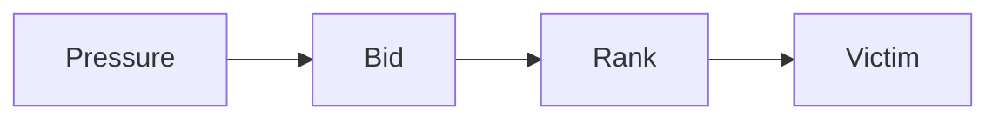

# utils · 论文库构建器

`utils/` 把 `papers/` 下的 Markdown 论文编译成可直接浏览的静态站点。页面、目录、
搜索索引、公式、图表、图片灯箱和视频容器都由这里的脚本生成；论文正文本身不需要写 HTML。

## 快速开始

```bash
# 构建全部论文（首次运行会创建 utils/.venv 并安装依赖）
./utils/build.sh

# 只校验，不写入页面
./utils/build.sh --check

# 构建并启动本地预览（默认 http://127.0.0.1:8765/）
./utils/build.sh --serve

# 把警告当成错误（适合发布前检查）
./utils/build.sh --strict

# 删除生成页面，保留 Markdown、PDF 和图片
./utils/build.sh --clean
```

生成的入口是 `papers/index.html`，也可以直接用浏览器打开（无需服务器）。

## 目录

```text
utils/
├── build.py                 # 构建入口 / 校验 / 本地预览
├── new_paper.py             # 新建论文目录与元数据骨架
├── build.sh                 # 自动创建 venv 并调用 build.py
├── requirements.txt         # Python 依赖（仅构建时需要）
├── site.yaml                # 站点标题、描述、导航、主色
├── paperlib/
│   ├── config.py            # 路径与站点配置
│   ├── discover.py          # 扫描 papers/*/meta.yaml
│   ├── markdown_ext.py      # 数学、Mermaid、视频、算法、图表处理
│   ├── render.py            # Jinja2 页面、目录、索引、JSON
│   ├── assets.py            # 复制 KaTeX/Mermaid、生成 Pygments CSS
│   └── validate.py          # 路径、标题层级、重复 id 校验
├── templates/               # base / index / paper / about 模板
├── static/                  # site.css、site.js、favicon
├── content/about.md         # 格式手册页面内容
└── vendor/                  # 本地 KaTeX 与 Mermaid（离线可用）
```

论文目录约定：

```text
papers/<slug>/
├── meta.yaml                # 必填：标题、作者、年份、标签、摘要
├── original.md              # 英文原文
├── zh.md                    # 中文译文（标题层级与原文一致）
└── assets/
    ├── source.pdf
    ├── cover.svg            # 可选封面
    └── figures/*.png        # 从 PDF 裁切的图
```

生成物：

```text
papers/
├── index.html               # 论文库首页
├── index.json               # 供程序读取的论文索引
├── assets/site/             # 样式、脚本、Pygments CSS
├── assets/vendor/           # KaTeX / Mermaid（本地副本）
├── about/index.html         # 格式手册
└── <slug>/
    ├── index.html           # 中文译文
    └── original/index.html  # 英文原文
```

## 新增一篇论文

```bash
python3 utils/new_paper.py \
  --slug my-paper \
  --title "Paper Title" \
  --title-zh "论文中文标题" \
  --url "https://example.com/paper.pdf" \
  --year 2026 \
  --authors "Alice; Bob" \
  --tags "LLM Serving,KV Cache"

# 编辑 meta.yaml、original.md、zh.md，把图表放进 assets/figures/
./utils/build.sh --check
./utils/build.sh
```

`new_paper.py` 会下载 PDF（若提供 URL），用 `pdfinfo` 读取页数、用 `pdftotext`
生成 `assets/source.txt` 参考文本，然后创建两版标题结构一致的骨架。

### meta.yaml 字段

| 字段 | 必填 | 说明 |
| --- | :---: | --- |
| `slug` | ✓ | 小写字母、数字、连字符；必须与目录名一致 |
| `title` | ✓ | 英文标题 |
| `title_zh` | ✓ | 中文标题 |
| `short_title` | | 侧栏和卡片使用的短标题 |
| `authors` | | 字符串列表；匿名论文写 `Anonymous Authors` |
| `affiliation` | | 机构 |
| `year` / `date` | ✓ | 年份与 ISO 日期，用于排序 |
| `venue` / `venue_zh` | | 发表信息；`venue` 用于 BibTeX，`venue_zh` 用于卡片/页眉 |
| `venue_full_zh` | | 完整中文会议名，用于来源区 |
| `conference_url` | | 会议官方页面 |
| `code_url` | | 代码仓库 |
| `provenance_note` / `provenance_note_en` | | 版本/来源说明，显示在作者行下方 |
| `tags` | ✓ | 字符串列表，用于筛选 |
| `abstract` / `abstract_zh` | ✓ | 摘要；用于卡片与 meta description |
| `summary` | | 一句话概括 |
| `cover` | | 相对论文目录的封面路径，如 `assets/cover.svg` |
| `pdf` | | 默认 `assets/source.pdf` |
| `source_url` | | 原文在线地址 |
| `pages` | | 原文页数 |
| `featured` | | 是否置顶到论文库首页 |
| `order` | | 同日期时的排序权重 |
| `citation_key` | | BibTeX key，默认由 slug + 年份生成 |

## Markdown 能力

### 数学

```markdown
行内：$U(b)=r/(\delta+\varepsilon)$

$$
U(b)=\frac{b.r}{b.\delta+\varepsilon}
\tag{2}
$$
```

构建器输出 KaTeX 可识别的标记，浏览器端本地渲染。公式块可横向滚动。

### Mermaid

````markdown

````

支持 `title="..."` 作为图注；图表可点击放大。Mermaid 资源在本地 `assets/vendor/mermaid/`。

### 图片

```markdown

```

单张图片会自动包成 `<figure>`，alt 文本作为图注；点击打开灯箱。
可用 `{.wide}` / `{.narrow}` 控制版式（attr_list 语法）。

### 视频

````markdown
```video
src: assets/demo.mp4
poster: assets/demo-poster.jpg
caption: 示例视频：KV 压力下的一次抢占与重算循环。
credit: 由 ffmpeg 生成，仅用于演示。
```
````

也支持 `src: https://www.youtube.com/watch?v=...` 或 Bilibili 链接，自动转为响应式
iframe。本地视频支持 `autoplay`、`loop`、`muted`、`width`、`start` 等字段。

### 代码块

````markdown
```python title="solver.py"
def utility(r, delta, eps=1e-3):
    return r / (delta + eps)
```
````

Pygments 在构建时高亮；页面脚本添加语言标签与复制按钮。

### 算法块

````markdown
```algorithm title="按效用排序的牺牲者顺序" label="算法 1"
输入: 投标池 P
1: for all b in P do
2:   U(b) <- b.r / (b.delta + eps)   ⊲ 回收效用
3: end for
```
````

算法块使用等宽排版、行号与注释样式，适合论文中的伪代码。

### 表格与图注

```markdown
表 2：速率敏感性。
{: .table-caption #tab-2 }

| 策略 | SLO |
| --- | ---: |
| BidKV | 83.2 |
```

`table-caption` 段落会与紧随其后的表格合并为语义化 `<figure>`；表格可横向滚动。
第一列为空的行会合并到上一行的 `rowspan`，适合“一个策略 × 多个速率”的数据表。

### 提示块

```markdown
!!! note "写作约定"
    术语第一次出现时保留英文原文。
```

## 双语与章节对齐

构建器会给每个 `h2`–`h4` 自动生成 `sec-*` 稳定 id。中英文两版必须保持相同的标题层级
（数量与层级一致），这样切换语言时 `#sec-4-2` 仍指向同一节。`--check` 会报告不一致，
并检查图片/视频路径、重复 id 和缺失资源。

## 站点配置

编辑 `utils/site.yaml` 修改站点标题、描述、导航和主色：

```yaml
title: "AI Infra 论文库"
description: "AI Infra 方向系统论文的中文精读与原文对照。"
accent: "#0f766e"
nav:
  - label: "论文库"
    href: "index.html"
  - label: "格式手册"
    href: "about/index.html"
```

## 依赖与离线

构建依赖见 `requirements.txt`（Markdown、pymdown-extensions、PyYAML、Jinja2、Pygments）。
`build.sh` 优先使用 `uv` 创建 `utils/.venv`，否则回退到 `python3 -m venv`。

KaTeX、Mermaid 和 Pygments CSS 都会复制到 `papers/assets/`，站点不依赖任何 CDN；
KaTeX 字体也在本地。浏览器打开 `papers/index.html` 即可离线阅读。

第三方资源与许可证见 `vendor/LICENSES.md`。

## 校验失败时

- **标题层级不一致**：检查两版的 `##` / `###` 数量与顺序。
- **图片不存在**：路径相对论文目录（如 `assets/figures/fig1.png`）。
- **重复 id**：避免在正文手写与自动 `sec-*` 冲突的 id。
- **视频路径不存在**：`assets/...` 必须存在于论文或 about 目录下。

`./utils/build.sh --clean` 只删除生成页面与 `papers/assets/` 下的构建资源，不会删除
论文 Markdown、PDF、图表或视频。

## GitHub Pages 自动部署

仓库根目录的 `.github/workflows/pages.yml` 会在推送到 `main` 时自动：

1. 安装 `utils/requirements.txt` 中的 Python 依赖；
2. 运行 `python utils/build.py --strict` 并校验论文；
3. 把生成的 `papers/` 目录作为 Pages artifact 上传；
4. 通过 GitHub Pages 官方 action 部署。

首次使用时，在仓库的 **Settings → Pages → Build and deployment** 中把 Source 设为
**GitHub Actions**。`configure-pages` 默认使用 `GITHUB_TOKEN`，因此不会代替你启用 Pages；
这一步需要手动完成一次。部署地址形如 `https://<user>.github.io/<repo>/`；站点内部全部
使用相对链接，因此放在项目子路径下也能正常工作。

只改 `notes/` 或 README 也会触发重新构建；如需限制触发路径，可在 workflow 的
`on.push` 下添加 `paths` 过滤。
